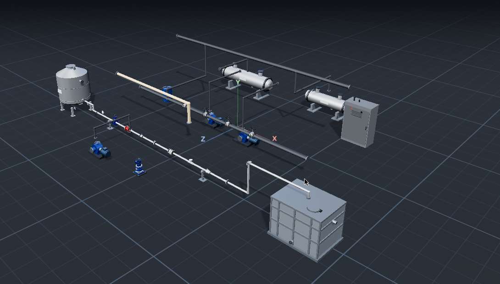
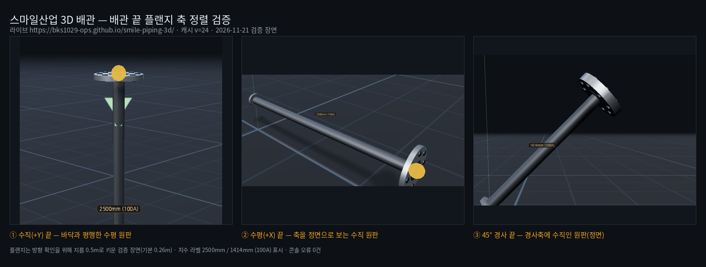
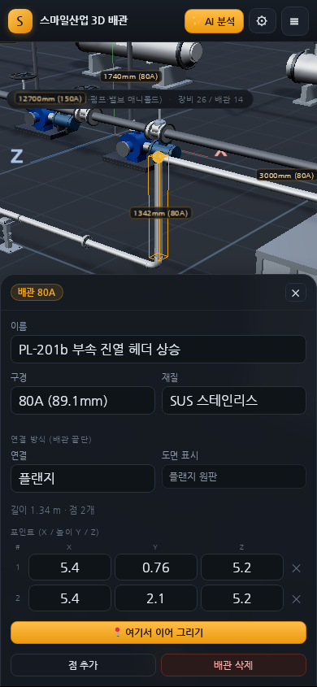

# 스마일산업 3D 배관 (Smile Piping 3D)

현장 사진·2D 도면·손그림을 바탕으로 **장비 위치와 배관 루트(경로·분기·밸브 위치)** 를
빠르게 3D로 잡고, 현장에서 돌려보며 설명하고, **Fusion 360**으로 넘길 수 있는 웹 프로토타입입니다.

- 라이브: https://bks1029-ops.github.io/smile-piping-3d/
- 단위: 미터(m), 1m 격자, Y축이 높이
- 설치 없이 브라우저에서 바로 실행 (Three.js 로컬 번들, CDN 의존 없음)





## 기능

1. **실시간 3D 뷰어** — OrbitControls 회전·확대·이동(모바일 터치 지원),
   등각 / 위에서 / 정면 / 리셋 뷰 전환, 1m 그리드와 X·Y·Z 축 표시
2. **기본 샘플 씬** — 현장 사진을 참고한 열교환기(쉘앤튜브·새들 지지대) 2기,
   원심펌프 3대(가로형·입형 인라인), 게이트밸브 4개 매니폴드, 상부·하부 배관, 제어반, 드럼,
   대형 원통 저장탱크·사각 수조, 그리고 헤더 1줄에 모은 표준 부속 진열 라인
3. **도면 바닥 깔기** — 사진·도면을 3D 바닥에 반투명으로 깔고 투명도·크기·회전·위치 조절
4. **장비·부속 라이브러리 26종 (카테고리별)**
   - 장비: **스팀/배관 헤더** · 열교환기 · 원심펌프 · 입형 인라인 펌프 · 탱크/드럼 · 대형 원통 저장탱크 · 사각 탱크(수조) · 제어반
   - 밸브: 게이트밸브 · 기어 버터플라이 · 경사형 체크·스트레이너 · 볼밸브 · 체크밸브(웨이퍼) · **안전·감압밸브**
   - **헤더(2026-11-22)** — 가로로 누운 원통형 배관 분배기(기본 2.4m × 지름 0.4m). 양단 접시형 경판,
     원통을 나누는 볼트 플랜지 2쌍, 바닥 새들 지지 프레임, 명판까지 그립니다.
     원통 중심은 바닥에서 `h×2`(기본 0.8m), **윗면은 `h×2.5`(기본 1.0m)** 라서 수직 분기관이 딱 여기서 올라갑니다.
     회전값 90°를 주면 앞뒤(Z) 방향으로 눕습니다. 위·아래·왼쪽·오른쪽 노즐은 아래 **장비 노즐(v60)** 설정을 따릅니다(기본 위 150A · 아래 50A).
   - **장비 노즐 (v60)** — 열교환기·헤더·탱크(원형/사각)·대형 저장탱크는 속성 패널에서 **위·아래·왼쪽·오른쪽**
     노즐 관경을 `없음`·`15A~200A` 중에 고를 수 있고, 고른 방향에만 장비 외벽에서 **노즐 목 + 플랜지**가 돌출됩니다.
     원심펌프는 **흡입(IN)·토출(OUT)** 두 곳(기본 200A·150A)이며 케이싱 앞(+Z)·위(+Y)에 섭니다.
     노즐 **끝(플랜지 접합면) 좌표가 그대로 ✏️ 손 그리기 스냅 자리**라서, 노즐 끝을 누르고 끌면 그 높이에서 관경까지
     노즐 것을 이어받아 배관이 뽑히고, 꺾이면 엘보가 자동으로 앉습니다. 속성 패널의 **📍 위·아래·왼쪽·오른쪽(펌프는 📍 IN·OUT)** 버튼은
     명령·조이스틱으로 이어 그릴 자리를 그 노즐 끝에 잡아 줍니다. `없음`으로 끄면 그 방향 노즐은 그려지지 않습니다.
     저장 JSON의 `nozzles`(방향별 관경)로 남고, Fusion 360 `.py`에도 같은 끝점 좌표로 목·플랜지 바디가 생깁니다.
   - **안전·감압밸브** — 세로 몸체 + 상부 스프링 보닛 + 측면 토출구. 기본이 세로(수직 배관 위)입니다.
   - **수직 배관 밸브(axis)** — 게이트·볼·버터플라이·체크·Y형·신축관·유량계·플랜지·니쁠·캡·유니온을
     속성 패널의 **방향(배관 축)** 에서 `수직 (Y)`로 고르면, 유로가 Y축으로 서고 **핸들은 옆(수평)으로** 나옵니다.
     `rot`을 주면 세워진 채로 핸들 방향만 돌아갑니다. 볼밸브 레버도 수직일 때 옆으로 눕습니다.
   - 피팅·서포트: 벨로우즈 신축관 · 90° 엘보 · **45° 엘보** · 티 분기관 · 레듀샤 ·
     **니쁠(단니쁠)** · **엔드캡(마개)** · **유니온(소켓)** · 플랜지 · 파이프 서포트
   - 계기: 압력계·온도계 · **유량계(플로우미터)**
     - **압력계·온도계는 배관 외벽에 니쁠로 직각 밀착**합니다(2026-11-22). 다이얼은 배관 바깥을 정면으로 보고,
       니쁠 끝은 관벽 안 10mm까지 꽂혀 뜨지 않으며, 위(+)·오른쪽·왼쪽·앞 등 어느 방향에 달아도
       배관 중심을 향해 똑바로 들어갑니다. AI 배치는 물론 명령·라이브러리로 달아도 바로 붙고,
       Fusion 360 스크립트에도 같은 축(법선 행렬)이 넘어갑니다.
   - 레듀샤·티는 **1차/2차 관경을 실제 외경으로 반영**합니다. `100a에서 50a 레듀샤`처럼 말하면
     큰 관경에서 작은 관경으로 줄어드는 원뿔로 그려지고, 이어지는 배관도 50A로 자동 전환됩니다.
     속성 패널에서 관경을 다시 바꿀 수도 있습니다.
   - **밸브·피팅 크기가 달린 배관 관경에 비례합니다**(2026-11-22). 게이트·볼·버터플라이·체크·Y형 밸브와
     벨로우즈·니쁠·캡·유니온·플랜지·유량계는 100A(외경 114.3mm) 실물 치수를 기준으로 관경 외경비만큼
     몸체·플랜지·면간거리가 커지고 줄어듭니다(높이는 대구경에서 덜 솟도록 외경비의 0.65제곱).
     그래서 `25a 볼벨브`는 폭 70mm·높이 155mm로 34mm 배관에 딱 맞게, `200a 볼벨브`는 폭 443mm로 216mm 배관에
     맞게 그려집니다. 속성 패널의 **달린 배관 관경**에서 관경을 바꾸면 그 비율로 크기가 다시 잡힙니다.
     예전에 저장한 도면의 밸브는 붙어 있는 배관 관경을 찾아 자동으로 크기를 맞춥니다.
   - 부속의 3D 메시 접합면 폭과 커서 전진 폭을 1:1로 맞춰, 배관→플랜지→밸브가 **틈 없이** 이어집니다.
   선택 후 위치·크기·회전·색상·이름 수정, 복제·삭제
   배관은 점을 찍어 파이프+엘보 자동 생성, 구경(**15A~600A** KS 표준 20종: 15·20·25·32·40·50·65·80·100·125·150·200·250·300·350·400·450·500·550·600A)·재질(흑관·SUS·보온) 선택
5. **AI 자동 분석 (선택)** — Google Gemini API 키를 넣으면 사진/손그림을 분석해
   장비·배관 JSON을 자동 생성 (키가 없어도 나머지 기능은 모두 동작)
   - **먼저 말로 정리하고 좌표를 만든다(2026-11-22)**: 응답 JSON 맨 앞의 `layoutPlan`에
     ① 메인 설비(헤더·탱크·펌프) 위치·크기·바닥 높이 ② 분기 배관의 수직/수평 방향과 시작·끝 좌표
     ③ 배관 위 밸브의 축(`axis`)과 높이 ④ 계기 자리를 6~10줄로 먼저 적고, 그 정리에 맞춰 좌표를 만듭니다.
     분석 결과 창에 이 구조 정리가 함께 보입니다.
   - **결정론적 기하 보정(sanitizeAiScene)**: AI가 뽑은 좌표를 그대로 그리지 않고 코드로 한 번 더 맞춥니다 —
     수직 배관 끝을 헤더·탱크 **윗면에 정확히 앉히고**(뜨거나 뚫지 않게), 직선 배관끼리 **0.15m 안에서 어긋난
     연결점은 붙이고**, 수직 배관 0.4m 안의 밸브·피팅은 **`axis=y`로 세워 배관 중심(x,z)에 스냅**하며,
     본체에 묻힌 부속은 **윗면 위로 끌어올리고**, **살짝 기운 수직관(0.3m 이상, 수평 편차 0.15m 이내)은
     아래 좌표에 맞춰 완전 수직**으로 바로 세우며(그 관의 밸브·계기도 새 좌표로 다시 맞춤),
     **압력계는 가장 가까운 배관 외벽에 니쁠을 직각으로 꽂아** 니쁠 끝이 벽 안 10mm까지 들어가고
     다이얼이 바깥을 정면으로 보게 붙입니다(수직관 옆·앞, 수평관 위 모두 같은 규칙).
     무엇이 자동으로 바로잡혔는지 배치 직후 알림에 요약됩니다(예: "수직 배관 밸브 3개 세움 · 묻힌 부속 1개 올림").
   - **색·재질 힌트**: 사진에서 읽은 색(적색 스팀 헤더 `#b04a35`, 은색 아연도 `#c8ced4`, 회색 안전밸브 등)을
     장비·배관 메쉬에 그대로 입혀 사진과 3D가 한눈에 맞습니다. 지정이 없으면 기존 재질색을 씁니다.
   - **관경 추론**: 헤더 지름·핸드휠·사람 키를 기준으로 주 분기 100A~150A, 계기·드레인 15A~25A처럼 비율로 잡습니다.
   분석하는 동안 화면 꺼짐을 막고(Screen Wake Lock), 창을 닫아도 분석은 계속되어 결과를 알려줍니다.
   - **사진 여러 장 동시 분석**: `✨ AI 분석` 창에서 사진·도면을 **최대 6장**까지 한 번에 고르거나 더 붙일 수 있고,
     썸네일마다 `×`로 한 장씩 빼거나 **전체 비우기**로 지웁니다. 사진은 긴 변 1600px·JPEG 0.82로 줄여
     한 번의 Gemini 요청(`parts`: 글 1 + 이미지 N)으로 보내고, 프롬프트가 여러 각도의 사진을 **하나의 3D 씬**으로
     종합하도록 안내합니다(같은 장비는 합치고, 다른 구역은 보이는 연결대로 이어 붙임).
   - 결과 창에서 **씬 교체**·**추가**를 누르면 분석 창(모바일 도구 서랍·속성 창·펼친 보기 바 포함)을 먼저 닫고
     배치를 적용한 뒤 등각 뷰로 새 배치에 화면을 맞춥니다 — 창이 3D 화면을 가리지 않습니다.
   - **도면은 도면대로, 사진은 보이는 대로 (v59)**: Gemini가 먼저 입력이 **2D 도면·제작도(`drawing`)** 인지
     **현장 사진(`photo`)** 인지 판별해 결과 JSON 최상위 `inputKind`로 돌려줍니다.
     도면이면 도면에 그려진 선·치수(mm)·관경·노즐 위치만 옮기고, 도면에 없는 긴 연결 배관·밸브·게이지·지지대를
     상상해 붙이지 않습니다. 단품 제작도의 노즐(`N1`·`N2`…)은 플랜지로 짧게 마감된 그대로(0.15~0.35m) 둡니다.
     기하 보정도 이를 따릅니다 — 도면 입력에서는 열린 끝 자동 연결(0.25~0.6m)을 끄고 0.12m 이하 초근접 정렬만 하며,
     장비에 붙은 0.4m 이하 배관(노즐)의 끝은 사진 입력에서도 다른 배관·노즐로 끌어다 꺾지 않습니다(길이 유지).
     사진 입력은 지금처럼 가려진 연결 흐름을 보이는 형태 그대로 자연스럽게 이어 줍니다.
6. **mm 한 줄 배관 명령** — 화면 아래 입력창에 현장 말투로 한 줄만 써도 배관이 이어집니다. API 없이 브라우저에서 즉시 실행.
   - `50a 오른쪽으로 1000 위로 1500` — 숫자는 **mm**(1.5m처럼 단위를 붙이면 미터)
   - `50a 오른쪽으로 1000 끝에 플렌지,다음 벨브,다음 플렌지,다음 1000,엘보써서 위로 1000`
   - 방향: 오른쪽(+X) 왼쪽(−X) 위(+Y) 아래(−Y) 앞(+Z) 뒤(−Z). 방향을 빼면 직전 방향으로 이어집니다(`다음 1000`).
   - 부속·장비 24종 별칭(플렌지·벨브·버터·스트레이너·후렉시블·엘보·레듀샤·니쁠·캡·유니온·유량계 등)은
     현재 위치에 진행 방향으로 붙고, 부속의 실제 길이만큼만 커서가 전진해 서로 겹치지도 떨어지지도 않습니다.
   - `25a 볼벨브` · `단조 25a 볼 벨브 오른쪽 1000` — 배관 없이 **부속부터** 시작해도 됩니다(지금 커서·방향, 없으면 오른쪽).
     `볼 벨브`·`체크 밸브`·`게이트 벨브`·`버터플라이 밸브`·`스윙 체크`·`경사 체크`·`스트레이너 벨브`처럼 띄어 써도 **한 부속**으로 봅니다.
   - `오른쪽 45도 위 1000` — 45° 경사 상승 1m(수직 0.71 · 수평 0.71)
   - `100a에서 50a 레듀샤` · `100x50 레듀샤` · `100a 티 50a 분기` — 이경 사이즈 반영
   - `새배관` · `되돌리기` · `초기화` · `?`(예시)
7. **방향 조이스틱 (타자 없이)** — 화면 왼쪽 아래의 작은 D패드에서 방향을 **고르면 그 방향이 주황색으로 강조**되고,
   명령창에 **`1000`처럼 길이(mm)만** 넣고 [실행]을 누르면 **방금 고른 방향**으로 배관이 그려집니다(같은 방향을 한 번 더 누르면 바로 그립니다).
   3×2 버튼에 ← ↑ → · 앞 ↓ 뒤 + `45°` 경사 토글 + `↩ 실행취소`, 맨 윗줄에 `내 시점 기준`·`연결 · 플랜지`가 **2열 1줄**로 들어 있어 높이가 낮습니다.
   - **위치**: 모바일에서는 **명령창이 화면 맨 아래 띠**(8~52px)를 차지하고, 조이스틱은 그 **바로 왼쪽 위(왼쪽 6px · 아래 58px)**에 딱 붙습니다 — 두 요소가 **겹치지 않습니다**(390×844 실측 겹침 0px²). 보기 바가 오른쪽 `등각` 1개로 접혀 있어 왼쪽 아래가 비어 있습니다.
   - **옮기기**: 상단 헤더(`내 시점`·`연결`)나 아래 정보 줄(⠿)을 **끌면 조이스틱이 화면 안 원하는 자리로 이동**합니다.
     화면 밖으로는 나가지 않고, 명령창·보기 바 위로는 내려가지 않습니다. 4px 넘게 끌었을 때만 이동으로 보고, 살짝 누르면 원래 버튼(방향 기준·연결 방식)이 그대로 동작합니다.
   - **기억/초기화**: 옮긴 자리는 브라우저에 기억되어(모바일·넓은 화면 따로) 다음에 열어도 그 자리에 있고, 정보 줄 오른쪽 **⟲**을 누르면 기본 자리(왼쪽 아래)로 돌아갑니다.
     `🧭 방향` 버튼으로 조이스틱을 접고 펼 수 있습니다.
   - **모바일 보기 바 접기**: 등각·위에서·정면·리셋·치수 다섯 버튼은 모바일에서 **`등각 ▲` 1개로 접혀** 있다가,
     누르면 나머지가 **위로 펼쳐집니다**(오른쪽 아래 8px · 아래 58px). 뷰를 고르면 그 뷰로 움직이며 바로 접히고,
     `📏 치수`는 접지 않고 켜고/끄기만 합니다. 다시 `등각`을 누르거나 화면 바깥(3D·명령창)을 터치하면 접힙니다.
     넓은 화면(>860px)은 기존처럼 상단 가로 보기 바 그대로입니다.
8. **🎤 말로 명령** — 명령창의 🎤을 누르고 말하면(Web Speech API, ko-KR) 받아쓰기해 바로 실행합니다.
   `오십에이 오른쪽 천`, `50에이 오른쪽 1000`, `천오백` 같은 구어체도 `50a`·`1000`·`1500`으로 알아듣습니다.
   듣는 동안 버튼에 빨간 점이 깜박이고, 브라우저가 지원하지 않거나 마이크 권한이 거부되면 안내 문구가 뜹니다.
9. **방향 기준 스위치 `[내 시점 기준]` ↔ `[도면 축 기준]`** — 기본값은 `[내 시점 기준]`.
   화면을 90°·180° 돌려도 지금 보는 쪽이 왼쪽·오른쪽·앞·뒤가 됩니다(카메라의 수평 전후·좌우를 가장 가까운 90° 축으로 스냅).
   `[도면 축 기준]`은 기존처럼 고정 X·Z 축이고, 위/아래는 항상 높이(Y)입니다.
10. **자동 엘보** — 배관을 이어 그리다 방향이 꺾이면 꼭짓점에 **90° 엘보 / 45° 엘보**가 각도에 맞춰 자동으로 들어갑니다.
   엘보는 **진입 벡터(inDir)·진출 벡터(outDir) 회전**으로 놓여 XY·YZ·XZ 어느 평면에서 꺾여도 두 입구가 배관과 반듯하게 일치합니다
   (예전에는 Y축 회전만 받아 엘보가 배관을 뚫고 비뚤어졌습니다). 관경(bore)에 맞춘 외경·긴 반경(1.5D) 곡률을 쓰고,
   배관은 엘보 접합면에서 끊겨 겹침 없이 이어집니다. `엘보써서 위로 1000`처럼 직접 말하면 엘보가 두 번 들어가지 않습니다.
   Fusion 360 `.py`에도 같은 치수·방향이 반영됩니다.
11. **🗑️ 새 도면** — 명령창의 🗑️ 버튼 또는 `새도면`·`전체삭제`·`다지워`·`처음부터` 명령으로 장비·배관을 한 번에 지우고
   커서를 원점 (0, 0.5, 0)으로 돌립니다. 바로 직전 상태로 **↩ 실행취소**할 수 있습니다.
12. **실행취소** — 명령창의 **↩ 실행취소** 버튼(또는 조이스틱의 ↩) 한 번으로 직전 명령·부속 추가가 취소되고
   커서·관경·방향도 그 전 자리로 돌아갑니다. `Ctrl+Z`도 같습니다.
13. **말하듯 쓰는 명령** — 조사·군더더기를 무시하고 현장 말투를 알아듣습니다.
   - `밸브 하나 달아줘` · `50미리 위로 좀 올려줘 500` · `오른쪽으로가 500` · `375 올려줘` · `지워`
   - `벨브에 붙혀줘` · `플랜지에 이어줘` — 지금 커서에서 가장 가까운 그 부속까지 배관으로 연결
   - `오른쪽 배관이랑 이어줘` · `배관 연결해줘` — 다른 배관 끝점까지 직교 경로(L자)로 연결
   - 그래도 못 알아들으면(설정에 Gemini API 키가 있을 때) 씬 요약과 함께 AI가 명령으로 바꿔 실행합니다.
14. **손가락 터치 선택** — 작은 밸브·피팅을 32px 안에서 집어 주고(근접 스냅), 선택하면 주황색 커서가
   그 부속의 출구로 옮겨가 바로 다음 배관을 이어 그릴 수 있습니다. 속성 패널의 **📍 여기서 이어 그리기** 버튼으로
   패널을 닫고 이어 그리면 됩니다.
15. **휴대폰 뒤로가기** — 모달·도구 서랍·속성 패널이 열려 있으면 뒤로가기 한 번에 그 창만 닫히고
   페이지는 그대로 남습니다(AI 분석 중에는 창만 접히고 분석은 계속).
16. **내보내기** — JSON 저장/불러오기, **Fusion 360 Python 스크립트(.py)**, **.obj 메쉬**
17. **📏 치수 표시** — 각 배관 구간 중점 옆에 **`1000mm (50A)`**(길이 mm + 관경) 라벨이 3D 좌표에 붙어 따라다닙니다.
   보기 바의 **📏 치수** 버튼으로 켜고 끄며(기본 켜짐), 선택은 `localStorage`(`smilePiping3D.dims`)에 기억됩니다.
18. **부속 축 정렬** — 배관 끝에 붙는 플랜지·밸브·피팅은 진행 방향 벡터(`dir`)로 3D 회전을 잡습니다.
   수직(+Y) 배관 끝 플랜지는 바닥과 평행한 수평 원판, 좌/우(±X)·앞/뒤(±Z) 배관 끝은 배관 축을 정면으로 바라보는 수직 원판,
   45° 경사관 끝은 경사축에 수직인 원판으로 배관 중심축에 딱 맞물립니다(예전에는 Y축 회전만 받아 90° 비뚤어졌습니다).
   Fusion 360 `.py`에도 같은 정렬 행렬(`rmat`)이 넘어갑니다.



19. **🔩 단조형(소켓웰드·나사식) 접합** — 플랜지 없이 소켓 보스·육각 칼라로 그리는 연결 방식.
   - 명령: `단조모드`·`단조타입`·`단조형`·`소켓타입`·`나사식` → 이후 배관·부속이 단조형, `플랜지모드`·`플렌지모드`·`플랜지타입`·`플랜지형` → 다시 플랜지.
   - 부속 앞에 `단조`·`소켓`·`나사`를 붙이면 그 한 개만 단조형: `단조 볼밸브` · `소켓 엘보` · `단조 티` · `단조 레듀샤` · `나사 밸브`.
   - 단조형 밸브·피팅·배관 끝단은 **플랜지 원판(볼트링) 대신 짧은 소켓 칼라 + 육각 조임부 + 용접 비드**로 그려집니다.
     (플랜지 부속 자체는 방식과 무관하게 그대로 플랜지)
   - 조이스틱의 **연결 · 플랜지 / 연결 · 단조** 버튼과 선택 부속·배관의 속성 패널에서 바로 바꿀 수 있고,
     조이스틱 상태줄(예: `50A · 단조 · 흑관·카본스틸 · …`)에 현재 방식이 표시됩니다.
   - 저장 JSON의 `conn`(`"flange"` 기본값 | `"forged"`)으로 남고, 기존 도면(값 없음)은 플랜지로 읽습니다.
     Fusion 360 `.py`도 `conn == 'forged'`일 때 플랜지 원판 대신 소켓 보스 바디를 생성합니다.


20. **✏️ 손 그리기** — 보기 바의 **✏️ 손 그리기**를 켜면 한 손가락 드래그가 카메라 회전 대신 **배관 그리기**가 됩니다(두 손가락 확대·이동은 그대로).
   - 끄는 방향을 현재 시점의 6개 3D 축(**+X·−X·+Y·−Y·+Z·−Z**) 화면 투영과 비교해 가장 가까운 축으로 스냅하고, 화면에 초록 원통 미리보기와 `X+ → 1,200mm` 표시를 보여 줍니다.
   - 조이스틱의 **45°** 를 켜면 6직각에 **12개 45° 대각선 방향**(XY·XZ·YZ 각 4방향)을 더해 견주므로, 화면에서 비스듬히 끌면 그 방향 그대로 45° 경사관이 그려집니다(미리보기 `45° → 1,200mm`). 꺾이면 **45° 엘보**가 자동으로 앉습니다. 45°가 켜져 있는 동안은 손 그리기 배지에 `45°` 표시가 붙습니다.
   - 길이는 **100mm 단위 반올림**, 최소 **300mm**. 손을 떼면 그 자리에 배관이 생기고, 이어서 다음 구간을 그을 수 있어 2~3번 끌면 꺾인 루트가 한 번에 나옵니다.
   - **그은 직후 배관 위에 치수(mm) 입력 창**이 바로 뜹니다. 숫자칸은 폭 92px·글자 16px로 고정해
     3~5자리(`180`·`1500`·`12000`)가 언제나 다 보이고, 창은 화면(키보드가 올라오면 줄어든 보이는 영역 포함) 밖으로
     나가지 않게 안쪽으로 밀어 넣습니다. 지금 길이가 들어 있고 숫자만 고쳐 `확인`(또는 Enter)을 누르면 그 구간 길이가 바뀌고, 시작점(초록 표시)도 새 끝점으로 따라가 다음 선이 어긋나지 않습니다. 숫자를 안 고치고 그냥 다음 선을 그으려면 3D 화면을 톡 누르면 됩니다 — 창이 조용히 닫히고 그대로 이어서 그려집니다. 창은 조이스틱·명령창·보기 바를 피해 배관 위(자리가 없으면 아래)에 붙고, 화면을 돌려도 배관을 따라갑니다.
   - 방향이 꺾이면 **자동 엘보**가 들어가고 앞 배관은 접합면에서 끊깁니다. 시작점은 기존 배관 끝·주황 커서 56px 안을 누르면 거기서 이어지고, 아니면 누른 바닥 자리입니다.
   - **두 점 찍기**: 시작점을 톡 누르고 끝점을 톡 누르면 같은 규칙으로 그 구간이 그려집니다.
   - 모바일에서는 보기 바를 **접어도 ✏️ 손 그리기 버튼이 항상 보입니다**(오른쪽 `등각` 바로 위). 한 번 더 누르거나 `Esc`로 끕니다.
21. **치수 라벨 탭 → 길이(mm) 정확히 고치기** — 화면의 치수 라벨(`1000mm (50A)`)을 누르면 그 구간 길이를 mm 숫자로 바꾸는 창이 뜹니다.
   바꾸면 그 구간 끝점부터 **뒤로 이어진 점·다른 배관·장비(엘보·밸브·설비)도 같이 이동**해 루트가 끊기지 않습니다(50~100,000mm, 지정한 구간 방향으로 늘고 줄어듦). 손으로 대충 그린 뒤 숫자로 다듬을 때 씁니다. 되돌리기는 `↩ 실행취소`.
22. **휴대폰 화면 확대 방지 — 두 손가락 확대는 3D 화면에서만** — 페이지 자체가 확대되어 속성(설정) 창까지 같이 커지며 잘리던 문제를 막았습니다.
   `viewport` meta(`maximum-scale=1.0, user-scalable=no, viewport-fit=cover`)에 더해, 툴바·패널·명령창·설정 창은 `touch-action: pan-x pan-y`(안쪽 스크롤은 그대로, 핀치·더블탭 확대만 끔), 3D 캔버스는 `touch-action: none`으로 잡아 확대가 시작되는 자리에서 막습니다.
   입력칸은 전부 16px 이상이라 iOS Safari·삼성 인터넷의 **포커스 자동 확대**도 일어나지 않습니다.
   브라우저의 '강제 확대' 설정처럼 그래도 확대된 상태가 되면, 속성 창·서랍이 지금 보이는 영역(`visualViewport`) 크기로 스스로 줄어 그 안에 앉습니다(확대가 풀리면 원래 배치로 복귀).





## 파일

```
index.html            화면
css/style.css         스타일
js/store.js           데이터 모델 · 샘플 씬
js/builders.js        3D 장비/배관 빌더 (Three.js)
js/fusion.js          Fusion 360 .py 생성기
js/obj.js             OBJ 내보내기
js/ai.js              Gemini 이미지 분석
js/cmd.js             mm 한 줄 배관 명령 파서 (한국어, 로컬)
js/dims.js            배관 치수 라벨 위치·문구 계산
js/main.js            앱 로직 · UI
vendor/               three.js r160 (로컬 번들)
```

## Fusion 360으로 넘기기

1. 앱에서 **[파일] → Fusion 360 스크립트(.py) 저장**
2. Fusion 360 → 도구 → 스크립트 및 추가기능 → 스크립트 탭 → 생성 → 스크립트
   (언어 Python, 이름 `SmilePiping3D`)
3. 생성된 `SmilePiping3D.py`를 내려받은 파일로 덮어쓰기
4. 스크립트 목록에서 실행 → 새 문서에 장비·배관이 실제 바디로 생성됩니다.

웹앱 1m = Fusion 내부 단위 100cm. Fusion 화면 단위를 mm로 두면 치수가 그대로 보입니다.
