# 스마일산업 3D 배관 (Smile Piping 3D)

현장 사진·2D 도면·손그림을 바탕으로 **장비 위치와 배관 루트(경로·분기·밸브 위치)** 를
빠르게 3D로 잡고, 현장에서 돌려보며 설명하고, **Fusion 360**으로 넘길 수 있는 웹 프로토타입입니다.

- 라이브: https://bks1029-ops.github.io/smile-piping-3d/
- 단위: 미터(m), 1m 격자, Y축이 높이
- 설치 없이 브라우저에서 바로 실행 (Three.js 로컬 번들, CDN 의존 없음)


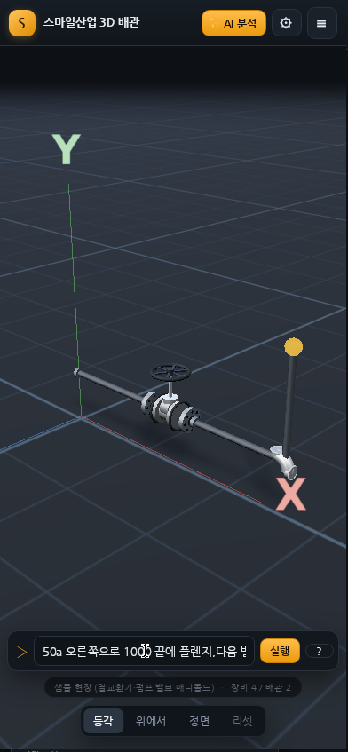


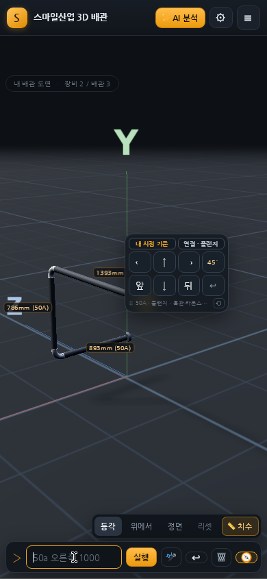

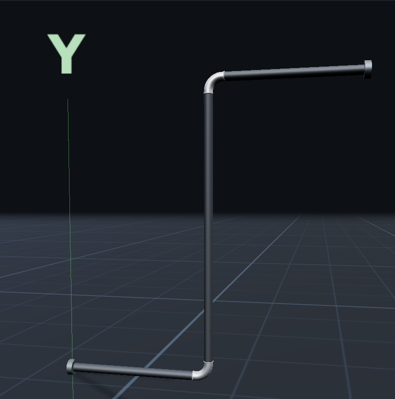


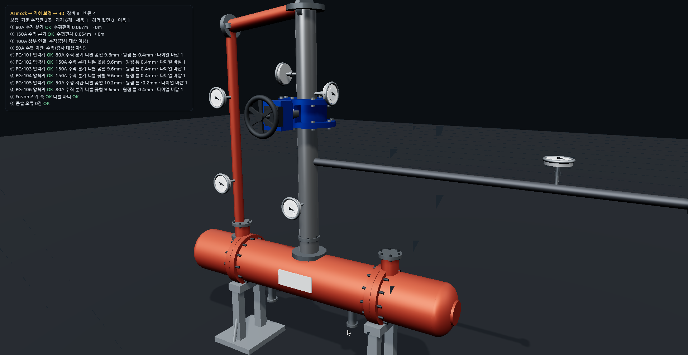

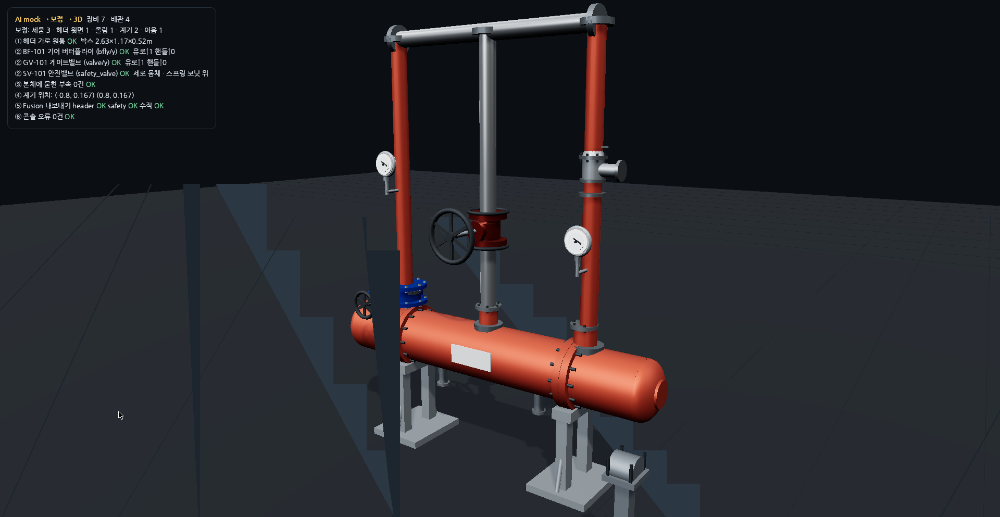

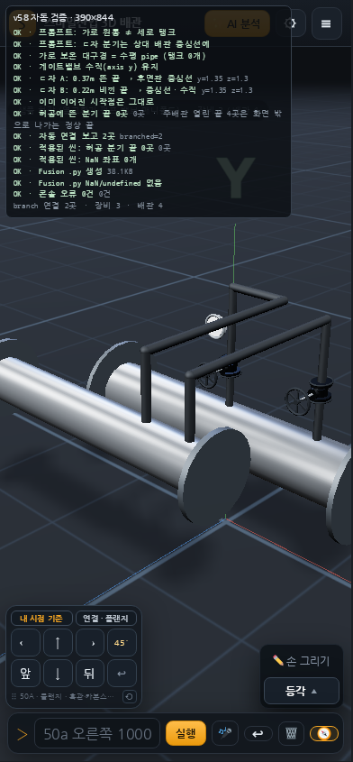


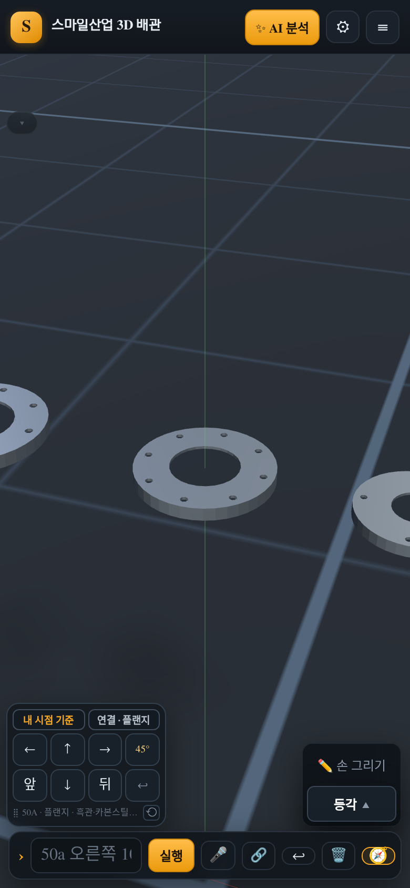

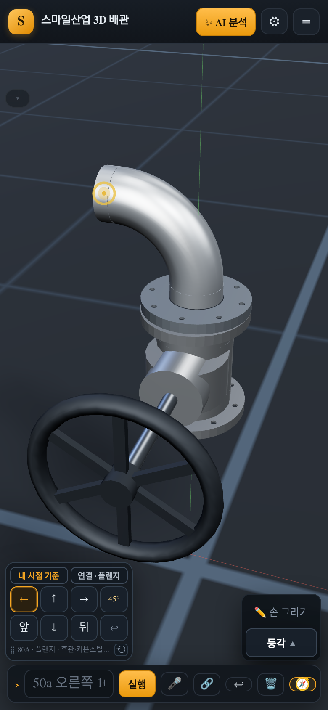

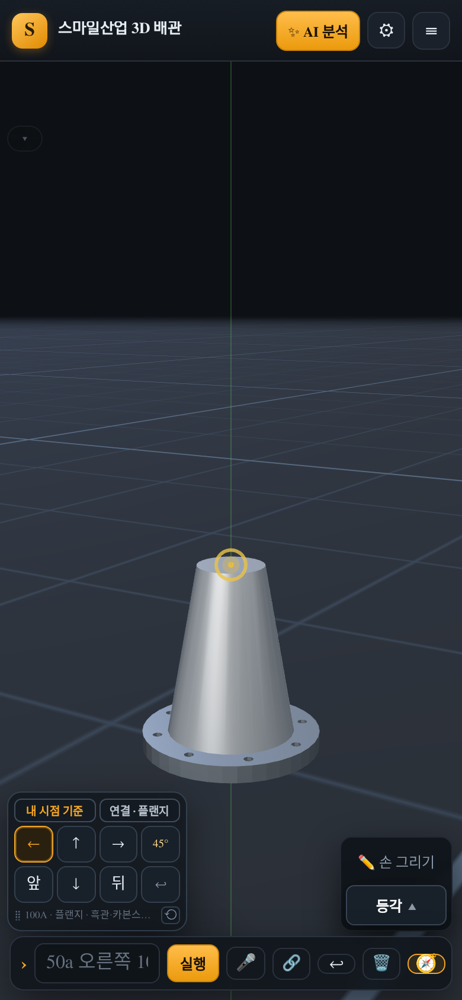

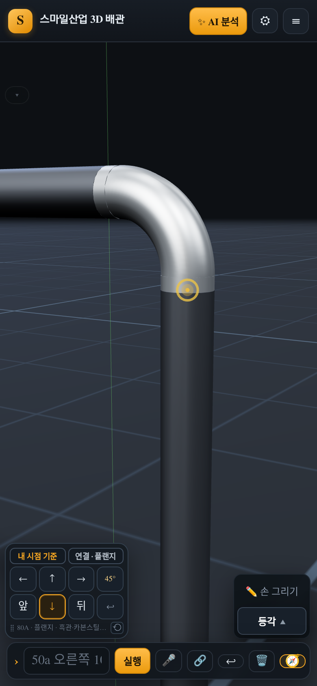


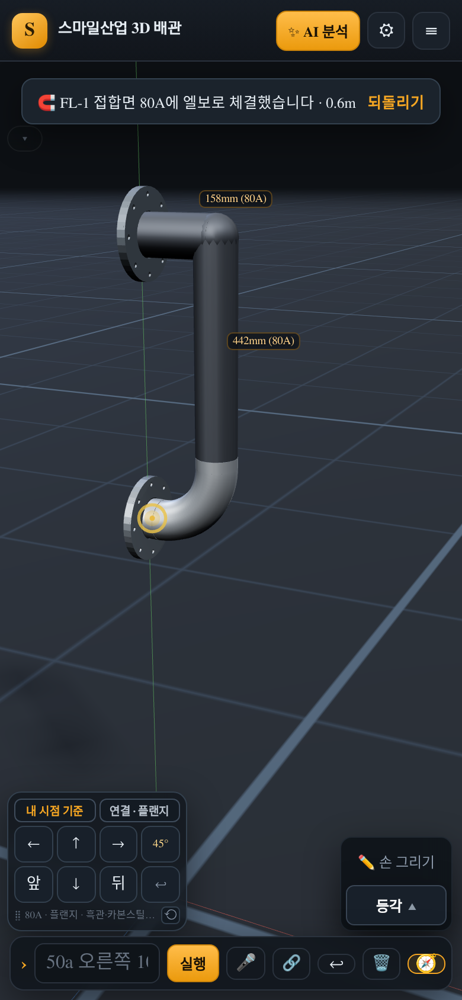


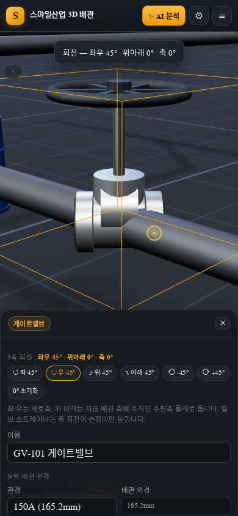


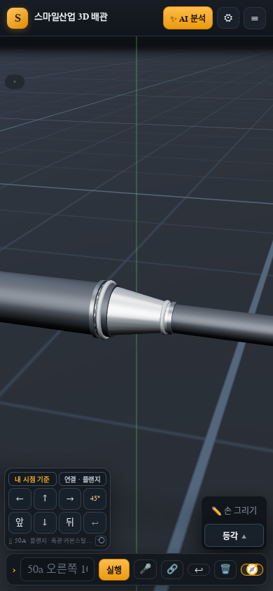


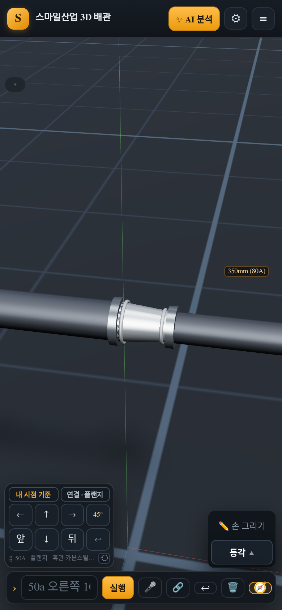


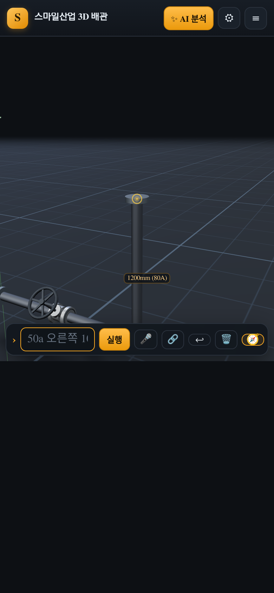


![열교환기 형상·자유 노즐·헤드 타입(v64, 390×844) — ① 새 열교환기는 실물 사진처럼 쉘 양끝에 볼트 체결 바디 플랜지 2쌍(둘레 볼트 16개씩)과 둥근 접시형 경판, 아래에 사각 새들 2개와 가로 보강 바를 갖는다. 노즐은 고정이 아니라 원하는 자리에 원하는 만큼(쉘 좌·중앙·우 / 좌·우 헤드 × 위·아래·앞·뒤·좌·우 끝) 뽑는다 — ①은 자유 노즐 5개. ② 노즐마다 [위치][방향][관경] 카드 + 프리셋(기본 상2·하2 / 상단 좌·우 + 우측 / 최소 / 헤드 좌·우 / 모두 비우기)과 노즐별 📍 이어그리기. ③ 헤드 타입 3종(양쪽 둥근 · 한쪽 둥근 · 양쪽 평판) — 열교환기를 고르면 타입 선택 창이 먼저 뜨고, 속성 패널에서 언제든 바꾼다. ④ 플랜지에 배관 없이 엘보를 바로 붙여도 출구면에 빈틈없이 맞닿는다(티는 분기 방향 위·아래·앞·뒤 + 직진 A·B·분기 세 접속구 모두에서 이어그리기). 390×844 라이브 자동검사 115항목 + 실제 탭 9항목 전부 PASS · 콘솔 오류 0](preview-v64-heatexchanger.png)

## 기능

1. **실시간 3D 뷰어** — OrbitControls 회전·확대·이동(모바일 터치 지원),
   등각 / 위에서 / 정면 / 리셋 뷰 전환, 1m 그리드와 X·Y·Z 축 표시
2. **기본 샘플 씬** — 현장 사진을 참고한 열교환기(쉘앤튜브·새들 지지대) 2기,
   원심펌프 3대(가로형·입형 인라인), 게이트밸브 4개 매니폴드, 상부·하부 배관, 제어반, 드럼,
   대형 원통 저장탱크·사각 수조, 그리고 헤더 1줄에 모은 표준 부속 진열 라인
3. **도면 바닥 깔기** — 사진·도면을 3D 바닥에 반투명으로 깔고 투명도·크기·회전·위치 조절
4. **장비·부속 라이브러리 26종 (카테고리별)**
   - 장비: **스팀/배관 헤더** · 열교환기 · 원심펌프 · 입형 인라인 펌프 · 탱크/드럼 · 대형 원통 저장탱크 · 사각 탱크(수조) · 제어반
   - 밸브: 게이트밸브 · 기어 버터플라이 · **Y자 스트레이너** · 볼밸브 · 체크밸브(웨이퍼) · **안전·감압밸브**
   - **헤더(2026-11-22)** — 가로로 누운 원통형 배관 분배기(기본 2.4m × 지름 0.4m). 양단 접시형 경판,
     원통을 나누는 볼트 플랜지 2쌍, 바닥 새들 지지 프레임, 명판까지 그립니다.
     원통 중심은 바닥에서 `h×2`(기본 0.8m), **윗면은 `h×2.5`(기본 1.0m)** 라서 수직 분기관이 딱 여기서 올라갑니다.
     회전값 90°를 주면 앞뒤(Z) 방향으로 눕습니다. 위·아래·왼쪽·오른쪽 노즐은 아래 **장비 노즐(v60)** 설정을 따릅니다(기본 위 150A · 아래 50A).
   - **장비 노즐 (v60)** — 열교환기·헤더·탱크(원형/사각)·대형 저장탱크는 속성 패널에서 **위·아래·왼쪽·오른쪽**
     노즐 관경을 `없음`·`15A~200A` 중에 고를 수 있고, 고른 방향에만 장비 외벽에서 **노즐 목 + 플랜지**가 돌출됩니다.
     원심펌프는 **흡입(IN)·토출(OUT)** 두 곳(기본 200A·150A)이며 케이싱 앞(+Z)·위(+Y)에 섭니다.
     노즐 **끝(플랜지 접합면) 좌표가 그대로 ✏️ 손 그리기 스냅 자리**라서, 노즐 끝을 누르고 끌면 그 높이에서 관경까지
     노즐 것을 이어받아 배관이 뽑히고, 꺾이면 엘보가 자동으로 앉습니다. 속성 패널의 **📍 위·아래·왼쪽·오른쪽(펌프는 📍 IN·OUT)** 버튼은
     명령·조이스틱으로 이어 그릴 자리를 그 노즐 끝에 잡아 줍니다. `없음`으로 끄면 그 방향 노즐은 그려지지 않습니다.
     **v61** — 장비를 고르기만 해도(그리고 `📍 여기서 이어 그리기`) 커서가 본체 윗면 허공이 아니라 **실제 노즐 끝**에 놓이고,
     방향은 노즐이 뻗는 쪽, 관경은 그 노즐 관경을 그대로 물려받습니다(펌프는 토출 OUT 우선 → 없으면 IN,
     열교환기·헤더·탱크는 첫 활성 노즐 위→아래→왼쪽→오른쪽). 조이스틱·명령으로 그린 배관의 시작점도 노즐 끝과 정확히 같고,
     노즐에서 바로 꺾는 명령은 엘보가 그 끝에 앉습니다. 노즐을 모두 끈 장비는 어디서 이어 그릴지 안내만 하고 커서를 그대로 둡니다.
     저장 JSON의 `nozzles`(방향별 관경)로 남고, Fusion 360 `.py`에도 같은 끝점 좌표로 목·플랜지 바디가 생깁니다.
     **v62** — 3D 화면에서 **노즐 끝을 손가락으로 직접 톡 누르면** 그 장비를 고르면서 **그 노즐로 커서·방향·관경이 바로 전환**됩니다.
     터치한 자리가 노즐 끝에서 화면 32px 이내이고 장비 본체 중심보다 그 노즐에 가까울 때 노즐 터치로 봅니다(25px는 되고 40px는 아님).
     펌프 IN·OUT과 열교환기·해더·탱크·대형 원통탱크·사각 탱크의 위·아래·왼쪽·오른쪽 — `equipNozzles()`를 쓰는 6종 전부가 같습니다.
     바로 이어 그릴 수 있도록 속성 창은 접어 두고, 토스트로 `📍 왼쪽 노즐 80A에서 이어 그립니다`처럼 어느 노즐에 붙었는지 알려 줍니다.
     장비 **본체**를 누를 때만 예전처럼 기본 노즐(펌프 OUT · 나머지 위) + 속성 창이 열리고, 노즐을 모두 끈 장비는 본체 터치로 그대로 고를 수 있습니다.
     보이는 노즐 목·플랜지가 본체 픽에 먼저 걸려도 노즐 터치가 먼저 가져가므로, 예전처럼 토출(OUT)이나 위 노즐로만 고정되던 불편이 없습니다.
   - **안전·감압밸브** — 세로 몸체 + 상부 스프링 보닛 + 측면 토출구. 기본이 세로(수직 배관 위)입니다.
   - **수직 배관 밸브(axis)** — 게이트·볼·버터플라이·체크·Y형·신축관·유량계·플랜지·니쁠·캡·유니온을
     속성 패널의 **방향(배관 축)** 에서 `수직 (Y)`로 고르면, 유로가 Y축으로 서고 **핸들은 옆(수평)으로** 나옵니다.
     `rot`을 주면 세워진 채로 핸들 방향만 돌아갑니다. 볼밸브 레버도 수직일 때 옆으로 눕습니다.
   - **3축 회전 (v67)** — 어떤 장비·부속이든(장비 8종 + 밸브·피팅·계기·서포트 = 26종 전부) 속성 패널 맨 위
     **`3축 회전`** 에서 `↺ 좌 45°`·`↻ 우 45°`(수평 회전, 월드 Y축), `⤴ 위 45°`·`⤵ 아래 45°`(지금 배관 축에
     수직인 수평축 둘레로 세우기·눕히기), `⟲ -45°`·`⟳ +45°`(제 유로 축 둘레 — 손잡이가 없는 Y자 스트레이너는 몸체·Y 바스켓이 함께 돈다)로
     45°씩 돌리고 `0° 초기화`로 한 번에 되돌립니다. 지금 각도는 제목 옆에 `좌우 45° · 위아래 0° · 축 0°`로 보이고,
     키보드가 올라오지 않는 버튼만 씁니다. 노즐·플랜지 접합면도 몸체와 함께 돌며, 각도는 자동 저장·JSON·
     Fusion 360 `rmat`까지 그대로 넘어가 다시 열거나 내보내도 유지됩니다.
     회전 전에 **닿아 있던 접합면(밸브 플랜지·티 접속구·배관 끝·엘보 다리 끝)을 기억**해 두고,
     회전 뒤 그 면에 **마주 보는 포트가 0mm로 다시 앉도록 중심(x·y·z)을 자동 보정**합니다 — 수직 밸브 위 티를
     돌려도 공중에 뜨지 않고 붙은 채로 돌아갑니다(티는 직진 A·B·분기 3개 포트를 대칭으로 봅니다).
   - 피팅·서포트: 벨로우즈 신축관 · 90° 엘보 · **45° 엘보** · 티 분기관 · 레듀샤 ·
     **니쁠(단니쁠)** · **엔드캡(마개)** · **유니온(소켓)** · 플랜지 · 파이프 서포트
   - 계기: 압력계·온도계 · **유량계(플로우미터)**
     - **압력계·온도계는 배관 외벽에 니쁠로 직각 밀착**합니다(2026-11-22). 다이얼은 배관 바깥을 정면으로 보고,
       니쁠 끝은 관벽 안 10mm까지 꽂혀 뜨지 않으며, 위(+)·오른쪽·왼쪽·앞 등 어느 방향에 달아도
       배관 중심을 향해 똑바로 들어갑니다. AI 배치는 물론 명령·라이브러리로 달아도 바로 붙고,
       Fusion 360 스크립트에도 같은 축(법선 행렬)이 넘어갑니다.
   - 레듀샤·티는 **1차/2차 관경을 실제 외경으로 반영**합니다. `100a에서 50a 레듀샤`처럼 말하면
     큰 관경에서 작은 관경으로 줄어드는 원뿔로 그려지고, 이어지는 배관도 50A로 자동 전환됩니다.
     속성 패널에서 관경을 다시 바꿀 수도 있습니다.
   - **밸브·피팅 크기가 달린 배관 관경에 비례합니다**(2026-11-22). 게이트·볼·버터플라이·체크·Y형 밸브와
     벨로우즈·니쁠·캡·유니온·플랜지·유량계는 100A(외경 114.3mm) 실물 치수를 기준으로 관경 외경비만큼
     몸체·플랜지·면간거리가 커지고 줄어듭니다(높이는 대구경에서 덜 솟도록 외경비의 0.65제곱).
     그래서 `25a 볼벨브`는 폭 70mm·높이 155mm로 34mm 배관에 딱 맞게, `200a 볼벨브`는 폭 443mm로 216mm 배관에
     맞게 그려집니다. 속성 패널의 **달린 배관 관경**에서 관경을 바꾸면 그 비율로 크기가 다시 잡힙니다.
     예전에 저장한 도면의 밸브는 붙어 있는 배관 관경을 찾아 자동으로 크기를 맞춥니다.
   - 부속의 3D 메시 접합면 폭과 커서 전진 폭을 1:1로 맞춰, 배관→플랜지→밸브가 **틈 없이** 이어집니다.
   - **플랜지 형상·접합면 정리 (v68)** — 플랜지 판은 **KS 10K 두께(14~22mm)** 의 얇은 링입니다. 가운데 내경이
     뚫려 있고 PCD 원주에 **볼트 구멍 4개(50A 이하)·8개(65A 이상)** 가 실제 구멍으로 나며, 판 속에 숨긴 어두운
     속판이 그 구멍들을 어둡게 보이게 합니다(예전에는 속이 꽉 찬 40~45mm 원판이라 '하키 퍽'으로 보였습니다).
     단독 플랜지·배관 끝 플랜지·밸브·펌프·장비 노즐 판이 **모두 한 표(flangeTh)** 를 씁니다.
     플랜지 부속의 **면간 두께 w = 판 두께**로 맞춰, 접합면(±w/2)이 곧 판의 바깥면입니다 — 플랜지 위에 엘보·배관을
     올리면 **0.0mm로 밀착**합니다(v68 실측: 밸브→플랜지→엘보 0.000m · 배관 끝→엘보 0.000m · 엘보 출구→배관 0.000m).
   - **용접표시 제거 (v68)** — 사용자 요청(`"용접표시 다 없어도 돼"`)대로 배관↔배관·엘보·45° 엘보·티·캡·레듀샤의
     용접 비드·칼라(토러스 링)를 전부 없앴습니다. 이제 접합면끼리 매끈하게 맞닿고, 단조형(소켓·나사)만 육각 소켓
     보스를 그립니다.
   - **레듀샤·티 치수 정합 (v68)** — 레듀샤는 양쪽 링 없이 매끈한 원뿔이고, 레듀샤·티 모두 **면간거리 w가 메쉬 길이**
     그대로여서 양 끝면(티는 세 접속구)이 접합면과 0mm로 일치합니다.
   - **엘보 방향은 언제나 진행 방향의 반대가 입구 (v68)** — 라이브러리·조이스틱·명령줄·손 그리기 어느 경로로
     놓아도 `inDir = -진행방향`, `outDir = 고른 출구`로 잡혀 입구 면이 직전 배관·플랜지와 마주 보고 0mm로 앉습니다
     (예전 명령줄 경로는 로컬 +X를 진행 방향으로 돌려 세워, 수직 밸브 위 엘보가 등으로 얹혀 뒤집혔습니다).
   - **Y자 스트레이너 실물형 (v69)** — 사용자 제보(`31601`·`31603`: *"손잡이 없는 y자 스트레이너이고 플렌지 크기는 왜케 안맞아"*)
     대로 손잡이·수직 스템을 완전히 빼고, 유로 직선 바디 + 양단 KS 10K 링 플랜지 + 45° Y 바스켓 + 볼트 캡(육각 플러그)만 남겼습니다.
     형상을 로컬 배율이 아니라 **처음부터 m 단위 실제 치수**로 그리도록 바꿔, 예전에 h·d 배율이 달라 판이 타원이 되고
     50A 판(195mm)이 80A(185mm)보다 커지던 문제를 없앴습니다 — 지금은 `flangeOd`·`flangeTh` 그대로(50A 155 < 65A 175 < 80A 185 < 100A 210mm).
     손잡이가 없으므로 `HANDLE_TYPES`에서도 빼 '핸들 방향' 칸이 뜨지 않습니다.
   - **관경·길이를 바꿔도 연결부를 파고들지 않음 (v69)** — 사용자 제보(`31603`: *"50a여서 80a로 변경하니까 배관을 잡아먹었어"*).
     바꾸기 전 **물려 있던 접합면을 기억**해 두고(상류 면 우선), 바꾼 뒤 그 면을 **0mm로 그 자리에 고정**한 채 반대쪽 자유단 방향으로만
     자라게 합니다. 그 뒤에 배관·부속이 이어져 있으면 자유단이 밀린 만큼 함께 밀어 겹침을 없앱니다.
     실측(50A→80A): 상류 면 0.000m 고정(파이프 이동 0), 하류 파이프 66mm 전진 연결 0.000m.
   - **자동 맞물림 플랜지 제거 (v69)** — 사용자 지시(*"자동으로 플렌지 붙는거 빼버려 … 벨브자체에 플렌지가 있으니까"*).
     밸브↔엘보·티·레듀샤 직결판(`buildMateFlanges`)과 배관 끝 맞물림 판을 없앴습니다. 이제 화면에 보이는 판은
     **사용자가 직접 놓은 `플랜지` 부속**과 부속·배관 자체의 판뿐이라 선택·삭제가 됩니다.
   - **양쪽 접합면 이어 그리기 (v69)** — 사용자 지시(*"엘보 이어그리기 양쪽 다 되야하는데 한쪽만 되고"* → *"엘보 뿐만 아니라 모두 다"*).
     엘보·밸브·스트레이너·레듀샤·플랜지·벨로우즈·유량계 등 2포트 부속은 속성 패널에 **앞·뒤 두 면 버튼**(`📍 왼쪽 80A` / `📍 오른쪽 80A`)이
     생기고, 누르면 그 면의 좌표·법선·관경으로 커서가 바로 넘어갑니다(티는 기존 3포트). 실측: 7종 × 2면 모두 커서 오차 0.000m · 방향 일치.
   - **손 그리기 → 플랜지·밸브 접합면 연결 (v69)** — 사용자 제보(*"손 그리기는 배관에는 잘 이어져 플렌지는 똑같이 안 이어지고"*).
     손 그리기 **시작점 후보**에 플랜지 부속·밸브·스트레이너의 플랜지 접합면을 넣어(예전에는 장비 노즐과 배관만),
     그 관경을 이어받고 법선 방향을 진행 방향으로 잡습니다. 꺾여 들어가면 그 자리에 엘보가 서서
     플랜지 면 ↔ 엘보 0.000m · 엘보 ↔ 배관 0.000m로 이어집니다(직선 진입은 엘보 없이 0.000m).
   - **드래그 접합면 자석 (v68)** — `🖐️ 드래그 이동`으로 부속을 끌어다 놓으면 0.25m 안의 가장 가까운 접합면
     (플랜지 면·노즐 끝·티 포트·배관 끝)에 **마주 보는 면을 우선해 0mm로 스냅**합니다(x·y·z 모두 맞춰 높이까지).
   - **이음부 플랜지 정리 (v67 → v68)** — 같은 관경 배관끼리 끝과 끝이 맞닿은 직선 이음에는 두툼한 플랜지 판을
     붙이지 않습니다(예전에는 이음마다 '중간 플랜지'처럼 튀어나왔습니다). v67에서는 용접 비드를 둘렀고,
     **v68에서는 그 비드·칼라까지 모두 지워** 이음선만 남깁니다. v69부터는 플랜지식 부속(밸브·스트레이너·신축관·유량계)과
     만날 때도 **자동 판을 더 그리지 않습니다** — 부속 자체 플랜지 면에 배관 끝이 그대로 닿습니다.
   선택 후 위치·크기·회전·색상·이름 수정, 복제·삭제
   배관은 점을 찍어 파이프+엘보 자동 생성, 구경(**15A~600A** KS 표준 20종: 15·20·25·32·40·50·65·80·100·125·150·200·250·300·350·400·450·500·550·600A)·재질(흑관·SUS·보온) 선택
5. **AI 자동 분석 (선택)** — Google Gemini API 키를 넣으면 사진/손그림을 분석해
   장비·배관 JSON을 자동 생성 (키가 없어도 나머지 기능은 모두 동작)
   - **먼저 말로 정리하고 좌표를 만든다(2026-11-22)**: 응답 JSON 맨 앞의 `layoutPlan`에
     ① 메인 설비(헤더·탱크·펌프) 위치·크기·바닥 높이 ② 분기 배관의 수직/수평 방향과 시작·끝 좌표
     ③ 배관 위 밸브의 축(`axis`)과 높이 ④ 계기 자리를 6~10줄로 먼저 적고, 그 정리에 맞춰 좌표를 만듭니다.
     분석 결과 창에 이 구조 정리가 함께 보입니다.
   - **결정론적 기하 보정(sanitizeAiScene)**: AI가 뽑은 좌표를 그대로 그리지 않고 코드로 한 번 더 맞춥니다 —
     수직 배관 끝을 헤더·탱크 **윗면에 정확히 앉히고**(뜨거나 뚫지 않게), 직선 배관끼리 **0.15m 안에서 어긋난
     연결점은 붙이고**, 수직 배관 0.4m 안의 밸브·피팅은 **`axis=y`로 세워 배관 중심(x,z)에 스냅**하며,
     본체에 묻힌 부속은 **윗면 위로 끌어올리고**, **살짝 기운 수직관(0.3m 이상, 수평 편차 0.15m 이내)은
     아래 좌표에 맞춰 완전 수직**으로 바로 세우며(그 관의 밸브·계기도 새 좌표로 다시 맞춤),
     **압력계는 가장 가까운 배관 외벽에 니쁠을 직각으로 꽂아** 니쁠 끝이 벽 안 10mm까지 들어가고
     다이얼이 바깥을 정면으로 보게 붙입니다(수직관 옆·앞, 수평관 위 모두 같은 규칙).
     무엇이 자동으로 바로잡혔는지 배치 직후 알림에 요약됩니다(예: "수직 배관 밸브 3개 세움 · 묻힌 부속 1개 올림").
   - **색·재질 힌트**: 사진에서 읽은 색(적색 스팀 헤더 `#b04a35`, 은색 아연도 `#c8ced4`, 회색 안전밸브 등)을
     장비·배관 메쉬에 그대로 입혀 사진과 3D가 한눈에 맞습니다. 지정이 없으면 기존 재질색을 씁니다.
   - **관경 추론**: 헤더 지름·핸드휠·사람 키를 기준으로 주 분기 100A~150A, 계기·드레인 15A~25A처럼 비율로 잡습니다.
   분석하는 동안 화면 꺼짐을 막고(Screen Wake Lock), 창을 닫아도 분석은 계속되어 결과를 알려줍니다.
   - **사진 여러 장 동시 분석**: `✨ AI 분석` 창에서 사진·도면을 **최대 6장**까지 한 번에 고르거나 더 붙일 수 있고,
     썸네일마다 `×`로 한 장씩 빼거나 **전체 비우기**로 지웁니다. 사진은 긴 변 1600px·JPEG 0.82로 줄여
     한 번의 Gemini 요청(`parts`: 글 1 + 이미지 N)으로 보내고, 프롬프트가 여러 각도의 사진을 **하나의 3D 씬**으로
     종합하도록 안내합니다(같은 장비는 합치고, 다른 구역은 보이는 연결대로 이어 붙임).
   - 결과 창에서 **씬 교체**·**추가**를 누르면 분석 창(모바일 도구 서랍·속성 창·펼친 보기 바 포함)을 먼저 닫고
     배치를 적용한 뒤 등각 뷰로 새 배치에 화면을 맞춥니다 — 창이 3D 화면을 가리지 않습니다.
   - **도면은 도면대로, 사진은 보이는 대로 (v59)**: Gemini가 먼저 입력이 **2D 도면·제작도(`drawing`)** 인지
     **현장 사진(`photo`)** 인지 판별해 결과 JSON 최상위 `inputKind`로 돌려줍니다.
     도면이면 도면에 그려진 선·치수(mm)·관경·노즐 위치만 옮기고, 도면에 없는 긴 연결 배관·밸브·게이지·지지대를
     상상해 붙이지 않습니다. 단품 제작도의 노즐(`N1`·`N2`…)은 플랜지로 짧게 마감된 그대로(0.15~0.35m) 둡니다.
     기하 보정도 이를 따릅니다 — 도면 입력에서는 열린 끝 자동 연결(0.25~0.6m)을 끄고 0.12m 이하 초근접 정렬만 하며,
     장비에 붙은 0.4m 이하 배관(노즐)의 끝은 사진 입력에서도 다른 배관·노즐로 끌어다 꺾지 않습니다(길이 유지).
     사진 입력은 지금처럼 가려진 연결 흐름을 보이는 형태 그대로 자연스럽게 이어 줍니다.
6. **mm 한 줄 배관 명령** — 화면 아래 입력창에 현장 말투로 한 줄만 써도 배관이 이어집니다. API 없이 브라우저에서 즉시 실행.
   - `50a 오른쪽으로 1000 위로 1500` — 숫자는 **mm**(1.5m처럼 단위를 붙이면 미터)
   - `50a 오른쪽으로 1000 끝에 플렌지,다음 벨브,다음 플렌지,다음 1000,엘보써서 위로 1000`
   - 방향: 오른쪽(+X) 왼쪽(−X) 위(+Y) 아래(−Y) 앞(+Z) 뒤(−Z). 방향을 빼면 직전 방향으로 이어집니다(`다음 1000`).
   - 부속·장비 24종 별칭(플렌지·벨브·버터·스트레이너·후렉시블·엘보·레듀샤·니쁠·캡·유니온·유량계 등)은
     현재 위치에 진행 방향으로 붙고, 부속의 실제 길이만큼만 커서가 전진해 서로 겹치지도 떨어지지도 않습니다.
   - `25a 볼벨브` · `단조 25a 볼 벨브 오른쪽 1000` — 배관 없이 **부속부터** 시작해도 됩니다(지금 커서·방향, 없으면 오른쪽).
     `볼 벨브`·`체크 밸브`·`게이트 벨브`·`버터플라이 밸브`·`스윙 체크`·`경사 체크`·`스트레이너 벨브`처럼 띄어 써도 **한 부속**으로 봅니다.
   - `오른쪽 45도 위 1000` — 45° 경사 상승 1m(수직 0.71 · 수평 0.71)
   - `100a에서 50a 레듀샤` · `100x50 레듀샤` · `100a 티 50a 분기` — 이경 사이즈 반영
   - `새배관` · `되돌리기` · `초기화` · `?`(예시)
7. **방향 조이스틱 (타자 없이)** — 화면 왼쪽 아래의 작은 D패드에서 방향을 **고르면 그 방향이 주황색으로 강조**되고,
   명령창에 **`1000`처럼 길이(mm)만** 넣고 [실행]을 누르면 **방금 고른 방향**으로 배관이 그려집니다(같은 방향을 한 번 더 누르면 바로 그립니다).
   3×2 버튼에 ← ↑ → · 앞 ↓ 뒤 + `45°` 경사 토글 + `↩ 실행취소`, 맨 윗줄에 `내 시점 기준`·`연결 · 플랜지`가 **2열 1줄**로 들어 있어 높이가 낮습니다.
   - **위치**: 모바일에서는 **명령창이 화면 맨 아래 띠**(8~52px)를 차지하고, 조이스틱은 그 **바로 왼쪽 위(왼쪽 6px · 아래 58px)**에 딱 붙습니다 — 두 요소가 **겹치지 않습니다**(390×844 실측 겹침 0px²). 보기 바가 오른쪽 `등각` 1개로 접혀 있어 왼쪽 아래가 비어 있습니다.
   - **옮기기**: 상단 헤더(`내 시점`·`연결`)나 아래 정보 줄(⠿)을 **끌면 조이스틱이 화면 안 원하는 자리로 이동**합니다.
     화면 밖으로는 나가지 않고, 명령창·보기 바 위로는 내려가지 않습니다. 4px 넘게 끌었을 때만 이동으로 보고, 살짝 누르면 원래 버튼(방향 기준·연결 방식)이 그대로 동작합니다.
   - **기억/초기화**: 옮긴 자리는 브라우저에 기억되어(모바일·넓은 화면 따로) 다음에 열어도 그 자리에 있고, 정보 줄 오른쪽 **⟲**을 누르면 기본 자리(왼쪽 아래)로 돌아갑니다.
     `🧭 방향` 버튼으로 조이스틱을 접고 펼 수 있습니다.
   - **모바일 보기 바 접기**: 등각·위에서·정면·리셋·치수 다섯 버튼은 모바일에서 **`등각 ▲` 1개로 접혀** 있다가,
     누르면 나머지가 **위로 펼쳐집니다**(오른쪽 아래 8px · 아래 58px). 뷰를 고르면 그 뷰로 움직이며 바로 접히고,
     `📏 치수`는 접지 않고 켜고/끄기만 합니다. 다시 `등각`을 누르거나 화면 바깥(3D·명령창)을 터치하면 접힙니다.
     넓은 화면(>860px)은 기존처럼 상단 가로 보기 바 그대로입니다.
8. **🎤 말로 명령** — 명령창의 🎤을 누르고 말하면(Web Speech API, ko-KR) 받아쓰기해 바로 실행합니다.
   `오십에이 오른쪽 천`, `50에이 오른쪽 1000`, `천오백` 같은 구어체도 `50a`·`1000`·`1500`으로 알아듣습니다.
   듣는 동안 버튼에 빨간 점이 깜박이고, 브라우저가 지원하지 않거나 마이크 권한이 거부되면 안내 문구가 뜹니다.
9. **방향 기준 스위치 `[내 시점 기준]` ↔ `[도면 축 기준]`** — 기본값은 `[내 시점 기준]`.
   화면을 90°·180° 돌려도 지금 보는 쪽이 왼쪽·오른쪽·앞·뒤가 됩니다(카메라의 수평 전후·좌우를 가장 가까운 90° 축으로 스냅).
   `[도면 축 기준]`은 기존처럼 고정 X·Z 축이고, 위/아래는 항상 높이(Y)입니다.
10. **자동 엘보** — 배관을 이어 그리다 방향이 꺾이면 꼭짓점에 **90° 엘보 / 45° 엘보**가 각도에 맞춰 자동으로 들어갑니다.
   엘보는 **진입 벡터(inDir)·진출 벡터(outDir) 회전**으로 놓여 XY·YZ·XZ 어느 평면에서 꺾여도 두 입구가 배관과 반듯하게 일치합니다
   (예전에는 Y축 회전만 받아 엘보가 배관을 뚫고 비뚤어졌습니다). 관경(bore)에 맞춘 외경·긴 반경(1.5D) 곡률을 쓰고,
   배관은 엘보 접합면에서 끊겨 겹침 없이 이어집니다. `엘보써서 위로 1000`처럼 직접 말하면 엘보가 두 번 들어가지 않습니다.
   Fusion 360 `.py`에도 같은 치수·방향이 반영됩니다.
11. **🗑️ 새 도면** — 명령창의 🗑️ 버튼 또는 `새도면`·`전체삭제`·`다지워`·`처음부터` 명령으로 장비·배관을 한 번에 지우고
   커서를 원점 (0, 0.5, 0)으로 돌립니다. 바로 직전 상태로 **↩ 실행취소**할 수 있습니다.
12. **실행취소** — 명령창의 **↩ 실행취소** 버튼(또는 조이스틱의 ↩) 한 번으로 직전 명령·부속 추가가 취소되고
   커서·관경·방향도 그 전 자리로 돌아갑니다. `Ctrl+Z`도 같습니다.
13. **말하듯 쓰는 명령** — 조사·군더더기를 무시하고 현장 말투를 알아듣습니다.
   - `밸브 하나 달아줘` · `50미리 위로 좀 올려줘 500` · `오른쪽으로가 500` · `375 올려줘` · `지워`
   - `벨브에 붙혀줘` · `플랜지에 이어줘` — 지금 커서에서 가장 가까운 그 부속까지 배관으로 연결
   - `오른쪽 배관이랑 이어줘` · `배관 연결해줘` — 다른 배관 끝점까지 직교 경로(L자)로 연결
   - 그래도 못 알아들으면(설정에 Gemini API 키가 있을 때) 씬 요약과 함께 AI가 명령으로 바꿔 실행합니다.
14. **손가락 터치 선택** — 작은 밸브·피팅을 32px 안에서 집어 주고(근접 스냅), 선택하면 주황색 커서가
   그 부속의 출구로 옮겨가 바로 다음 배관을 이어 그릴 수 있습니다. 속성 패널의 **📍 여기서 이어 그리기** 버튼으로
   패널을 닫고 이어 그리면 됩니다.
15. **휴대폰 뒤로가기** — 모달·도구 서랍·속성 패널이 열려 있으면 뒤로가기 한 번에 그 창만 닫히고
   페이지는 그대로 남습니다(AI 분석 중에는 창만 접히고 분석은 계속).
16. **내보내기** — JSON 저장/불러오기, **Fusion 360 Python 스크립트(.py)**, **.obj 메쉬**
17. **📏 치수 표시** — 각 배관 구간 중점 옆에 **`1000mm (50A)`**(길이 mm + 관경) 라벨이 3D 좌표에 붙어 따라다닙니다.
   보기 바의 **📏 치수** 버튼으로 켜고 끄며(기본 켜짐), 선택은 `localStorage`(`smilePiping3D.dims`)에 기억됩니다.
18. **부속 축 정렬** — 배관 끝에 붙는 플랜지·밸브·피팅은 진행 방향 벡터(`dir`)로 3D 회전을 잡습니다.
   수직(+Y) 배관 끝 플랜지는 바닥과 평행한 수평 원판, 좌/우(±X)·앞/뒤(±Z) 배관 끝은 배관 축을 정면으로 바라보는 수직 원판,
   45° 경사관 끝은 경사축에 수직인 원판으로 배관 중심축에 딱 맞물립니다(예전에는 Y축 회전만 받아 90° 비뚤어졌습니다).
   Fusion 360 `.py`에도 같은 정렬 행렬(`rmat`)이 넘어갑니다.


18-0. **v66 (2026-11-25)** — ① **밸브 핸들만 관 축 둘레로 45°·90°**(`spec.roll`, 속성 패널 버튼, Fusion rmat까지 같은 회전) ② **플랜지 외경을 KS 10K 표로 통일**(`flangeOd(bore)` — 부속·배관 끝·맞물림 판·밸브 자기 플랜지가 같은 값, 볼트 제거하고 원판+개스킷만) ③ **밸브↔엘보·티·레듀샤 직결에도 맞물림 판 1장**(수동 플랜지가 있으면 중복 금지) ④ **플랜지 위 엘보는 조이스틱으로 고른 방향이 출구** ⑤ **개수 HUD를 ▾ 칩으로 접기** ⑥ **모바일 키보드가 올라오면 조이스틱·보기 바 숨기고 커서를 3D 화면 가운데로**. 390×844 자동검사 72항목 전부 PASS · 콘솔 오류 0.

18-1. **플랜지 밸브에 맞물리는 배관 플랜지(v63 → v69 제거)** — v63에서 플랜지로 체결하는 부속(게이트·버터플라이·볼·체크·벨로우즈·유량계·플랜지)의
   접합면에 배관 쪽 판을 한 장 자동으로 붙였으나, **v69에서 사용자 지시로 없앴습니다**
   (*"자동으로 플렌지 붙는거 빼버려 따로 선택도 안돼서 지우지도 못하고 … 자동으로 붙이는건 빼자"*).
   지금은 부속 자체 플랜지 면에 배관 끝이 그대로 닿고, 판이 필요하면 `플랜지` 부속을 직접 놓습니다.
   - 판정은 부속의 유로 축(`dir`, 없으면 `axis`·`rot`)과 면간거리(`w/2`)로 합니다 — 축에서 비껴난 본체 옆·위에는 붙지 않고,
     밸브를 놓고 이어 그리든 배관을 먼저 긋고 밸브를 놓든, 45° 경사·수직관이든 접합면마다 정확히 1장입니다(겹침 없음).
   - 배관을 단조(용접) 모드로 그리던 중이라도 부속이 플랜지식이면 플랜지로 이어집니다. 단조형 밸브·엘보 용접 이음·장비 노즐에는 판을 더 그리지 않습니다.
   - 커서(주황)도 함께 줄였습니다 — 반지름 70mm 불투명 공 → 화면에서 늘 12~16px인 반투명 점(불투명도 0.34) + 위치 심 + 얇은 링이라,
     확대해도 소구경(50A) 배관 끝·플랜지·밸브를 가리지 않습니다(작업 거리 1.2~3m에서 예전 지름의 14~32%).

18-2. **열교환기 형상 · 자유 노즐 · 헤드 타입(v64)** — 실물 사진(2026-11-25)을 그대로 살췄습니다.
   - **형상**: 쉘 양끝에 **볼트 체결 바디 플랜지 2쌍**(둘레 볼트 16개씩 · 개스킷 틈) + **둥근 접시형 경판**, 아래에 **사각 새들 2개와 가로 보강 바**를 이은 프레임, 명판·리프팅 러그까지. `store.js hxBody()` 한 곳의 치수를 `builders.js`(3D)·`fusion.js`(.py)·노즐 좌표가 함께 씁니다.
   - **헤드 타입 3종**: `양쪽 둥근`(기본) · `한쪽 둥근`(왼쪽 경판 · 오른쪽 평판 커버, rot 180°로 반전) · `양쪽 평판`(양쪽 볼트 커버). **열교환기를 고르면 타입 선택 창이 먼저 뜨고**, 명령에 `열교환기 양쪽/한쪽/평판`처럼 타입을 말하면 바로 놓이며, 속성 패널에서 언제든 바꿉니다.
   - **노즐 자유 배치**: 열교환기는 노즐이 정해져 있지 않습니다 — 노즐마다 **위치**(좌측 헤드 · 쉘 좌측 · 쉘 중앙 · 쉘 우측 · 우측 헤드) × **방향**(위·아래·앞·뒤·좌측 끝·우측 끝) × **관경**(15A~200A)을 고르고 `＋ 노즐 추가` / `✕`로 개수를 정합니다. 프리셋 5종(기본 상2·하2 / 상단 좌·우 + 우측 / 최소 상1·하1 / 헤드 좌·우 / 모두 비우기).
   - 저장은 `nozList:[{nid,at,dir,bore}]` — 예전 도면의 `nozzles:{up,down,left,right}`는 같은 자리(쉘 중앙 위 · 좌측 헤드 좌측 끝)의 자유 노즐로 자동 변환됩니다. 노즐 끝 좌표는 그대로 손 그리기 스냅·이어그리기·3D 탭 전환·Fusion `.py` 노즐 목록에 쓰입니다.

18-3. **티 · 플랜지 직결 · 엘보 이어 붙이기(v64)**
   - **티**: 주배관/분기 **관경을 따로**(이경 티) 고르고, **분기 방향을 위·아래·앞·뒤로 회전**합니다. **직진 A · 직진 B · 분기** 세 접속구를 3D에서 직접 누르거나 속성 패널 📍 버튼으로 골라 각각 이어 그립니다(관경은 그 포트 것을 그대로).
   - **플랜지에 배관 없이 바로**: 플랜지(`flange`)·밸브·노즐 출구면에서 `90° 엘보`·`티`·`레듀샤`·`캡`을 놓으면 접합면 중심에 진행 방향까지 맞춰 앉고 커서가 그 출구로 넘어갑니다. v69부터는 어느 쪽에도 판을 더 그리지 않습니다 — 플랜지·밸브·스트레이너의 자기 판에만 배관·엘보가 0mm로 닿습니다.
   - **라이브러리 부속이 배관 끝에 붙음**: 커서가 배관 끝·플랜지 면에 있으면 그 접합면에 정확히 앉고, 엘보는 꺾임점을 face만큼 앞에 두고 **커서가 출구 끝으로** 이동합니다(예전에는 화면 가운데에 놓여 배관과 떨어졌습니다).

18-4. **🔗 잇기 · 🧲 자석 스냅 · 이동·정렬(v64)**
   - **🔗 잇기**(명령창 🔗 버튼): 켠 뒤 접속구(티·노즐·배관 끝)를 한 번 탭하면 **현재 커서에서 그 포트까지 직선/90° 경로로 배관이 바로 연결**되고, 관경은 그 포트 것을 따르며 잇기는 자동으로 꺼집니다.
   - **🧲 손 그리기 자석**: 끝점을 기존 접속구 근처(화면 26px)로 가져가면 청록 링과 함께 **착 붙고**, 손가락을 범위 밖으로 떼면 바로 풀려 자유 길이로 그립니다.
   - **위치 이동**: 선택한 장비·부속을 `← → 앞 뒤 ↑ ↓` 버튼 × 단위(100/500/1000mm)로 옮기고, **✋ 드래그 이동**을 켜면 3D 바닥을 끌어 옮깁니다. 다른 장비의 X·Z에서 **150mm 안이면 축에 딱 스냅**되고 하늘색 점선 정렬 안내선 + 이동 중 십자선이 떠서 나란히 맞춘 걸 바로 확인합니다(↩ 한 번이면 되돌림).
   - **명령창 연속 입력**: 명령을 실행해도 입력칸 초점(모바일 키보드)이 유지되고, **3D 화면을 터치하면 키보드가 바로 내려갑니다**. 속성 창을 열면 명령창 초점은 풀리고 창 안 입력칸에는 자동 초점을 주지 않습니다(직접 누를 때만 키보드).
   - **빈 바닥 탭** → 노란 커서가 그 자리(0.1m 격자)로 옮겨 가 새 그림을 시작합니다.
   - **치수 라벨**: 기본은 **선택한(또는 방금 그린) 배관 1개만** 표시하고, 📏 치수를 켜면 모든 배관 라벨을 한꺼번에 보여 줍니다(라벨도 조금 슬림하게).

19. **🔩 단조형(소켓웰드·나사식) 접합** — 플랜지 없이 소켓 보스·육각 칼라로 그리는 연결 방식.
   - 명령: `단조모드`·`단조타입`·`단조형`·`소켓타입`·`나사식` → 이후 배관·부속이 단조형, `플랜지모드`·`플렌지모드`·`플랜지타입`·`플랜지형` → 다시 플랜지.
   - 부속 앞에 `단조`·`소켓`·`나사`를 붙이면 그 한 개만 단조형: `단조 볼밸브` · `소켓 엘보` · `단조 티` · `단조 레듀샤` · `나사 밸브`.
   - 단조형 밸브·피팅·배관 끝단은 **플랜지 원판(볼트링) 대신 짧은 소켓 칼라 + 육각 조임부 + 용접 비드**로 그려집니다.
     (플랜지 부속 자체는 방식과 무관하게 그대로 플랜지)
   - 조이스틱의 **연결 · 플랜지 / 연결 · 단조** 버튼과 선택 부속·배관의 속성 패널에서 바로 바꿀 수 있고,
     조이스틱 상태줄(예: `50A · 단조 · 흑관·카본스틸 · …`)에 현재 방식이 표시됩니다.
   - 저장 JSON의 `conn`(`"flange"` 기본값 | `"forged"`)으로 남고, 기존 도면(값 없음)은 플랜지로 읽습니다.
     Fusion 360 `.py`도 `conn == 'forged'`일 때 플랜지 원판 대신 소켓 보스 바디를 생성합니다.


20. **✏️ 손 그리기** — 보기 바의 **✏️ 손 그리기**를 켜면 한 손가락 드래그가 카메라 회전 대신 **배관 그리기**가 됩니다(두 손가락 확대·이동은 그대로).
   - 끄는 방향을 현재 시점의 6개 3D 축(**+X·−X·+Y·−Y·+Z·−Z**) 화면 투영과 비교해 가장 가까운 축으로 스냅하고, 화면에 초록 원통 미리보기와 `X+ → 1,200mm` 표시를 보여 줍니다.
   - 조이스틱의 **45°** 를 켜면 6직각에 **12개 45° 대각선 방향**(XY·XZ·YZ 각 4방향)을 더해 견주므로, 화면에서 비스듬히 끌면 그 방향 그대로 45° 경사관이 그려집니다(미리보기 `45° → 1,200mm`). 꺾이면 **45° 엘보**가 자동으로 앉습니다. 45°가 켜져 있는 동안은 손 그리기 배지에 `45°` 표시가 붙습니다.
   - 길이는 **100mm 단위 반올림**, 최소 **300mm**. 손을 떼면 그 자리에 배관이 생기고, 이어서 다음 구간을 그을 수 있어 2~3번 끌면 꺾인 루트가 한 번에 나옵니다.
   - **그은 직후 배관 위에 치수(mm) 입력 창**이 바로 뜹니다. 숫자칸은 폭 92px·글자 16px로 고정해
     3~5자리(`180`·`1500`·`12000`)가 언제나 다 보이고, 창은 화면(키보드가 올라오면 줄어든 보이는 영역 포함) 밖으로
     나가지 않게 안쪽으로 밀어 넣습니다. 지금 길이가 들어 있고 숫자만 고쳐 `확인`(또는 Enter)을 누르면 그 구간 길이가 바뀌고, 시작점(초록 표시)도 새 끝점으로 따라가 다음 선이 어긋나지 않습니다. 숫자를 안 고치고 그냥 다음 선을 그으려면 3D 화면을 톡 누르면 됩니다 — 창이 조용히 닫히고 그대로 이어서 그려집니다. 창은 조이스틱·명령창·보기 바를 피해 배관 위(자리가 없으면 아래)에 붙고, 화면을 돌려도 배관을 따라갑니다.
   - 방향이 꺾이면 **자동 엘보**가 들어가고 앞 배관은 접합면에서 끊깁니다. 시작점은 기존 배관 끝·주황 커서 56px 안을 누르면 거기서 이어지고, 아니면 누른 바닥 자리입니다.
   - **플랜지·밸브·스트레이너·펌프의 접합면도 자석 자리입니다(v67 → v69 손 그리기 시작점까지)** — 손으로 배관을 그 면 근처(화면 26px)로 가져가면 `🧲 게이트밸브 접합면`에 붙고, 90°로 꺾여 들어가면 그 꺾임에 **엘보를 세워** 배관을 엘보 접합면에서 끊습니다. 그래서 플랜지 면 ↔ 엘보 ↔ 배관이 0mm로 이어집니다(v69에서 자동 맞물림 판을 없앤 뒤에도 실측 0.000m). 접합면 쪽으로 곧장 들어오는 배관은 엘보 없이 면에 바로 붙습니다.
   - **두 점 찍기**: 시작점을 톡 누르고 끝점을 톡 누르면 같은 규칙으로 그 구간이 그려집니다.
   - 모바일에서는 보기 바를 **접어도 ✏️ 손 그리기 버튼이 항상 보입니다**(오른쪽 `등각` 바로 위). 한 번 더 누르거나 `Esc`로 끕니다.
21. **치수 라벨 탭 → 길이(mm) 정확히 고치기** — 화면의 치수 라벨(`1000mm (50A)`)을 누르면 그 구간 길이를 mm 숫자로 바꾸는 창이 뜹니다.
   바꾸면 그 구간 끝점부터 **뒤로 이어진 점·다른 배관·장비(엘보·밸브·설비)도 같이 이동**해 루트가 끊기지 않습니다(50~100,000mm, 지정한 구간 방향으로 늘고 줄어듦). 손으로 대충 그린 뒤 숫자로 다듬을 때 씁니다. 되돌리기는 `↩ 실행취소`.
21-1. **속성 시트가 골라도 가리지 않게 (v67)** — 모바일 속성 시트는 화면 아래 **40dvh**까지만 쓰고,
   부속·배관을 고르면 그 대상이 **시트 위에 남은 3D 영역 한가운데**로 오도록 표적·카메라를 380ms 동안 부드럽게 옮깁니다
   (보는 각도는 그대로, 너무 멀리서 골랐으면 화면에서 보이게 적당히 당겨 옵니다). 같은 대상을 고른 채
   회전 버튼을 눌러도 화면을 다시 잡지 않아, 위쪽 화면에서 돌아가는 모습을 그대로 볼 수 있습니다.
22. **휴대폰 화면 확대 방지 — 두 손가락 확대는 3D 화면에서만** — 페이지 자체가 확대되어 속성(설정) 창까지 같이 커지며 잘리던 문제를 막았습니다.
   `viewport` meta(`maximum-scale=1.0, user-scalable=no, viewport-fit=cover`)에 더해, 툴바·패널·명령창·설정 창은 `touch-action: pan-x pan-y`(안쪽 스크롤은 그대로, 핀치·더블탭 확대만 끔), 3D 캔버스는 `touch-action: none`으로 잡아 확대가 시작되는 자리에서 막습니다.
   입력칸은 전부 16px 이상이라 iOS Safari·삼성 인터넷의 **포커스 자동 확대**도 일어나지 않습니다.
   브라우저의 '강제 확대' 설정처럼 그래도 확대된 상태가 되면, 속성 창·서랍이 지금 보이는 영역(`visualViewport`) 크기로 스스로 줄어 그 안에 앉습니다(확대가 풀리면 원래 배치로 복귀).

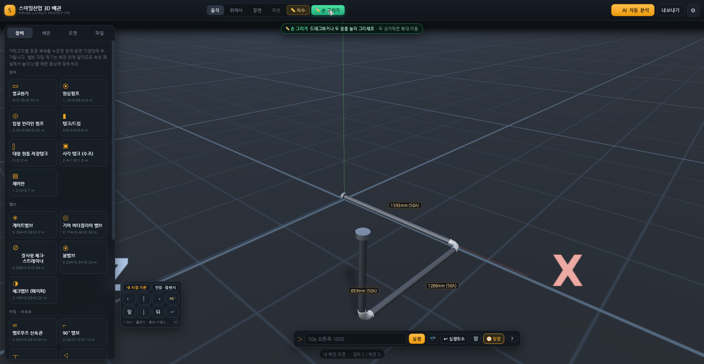

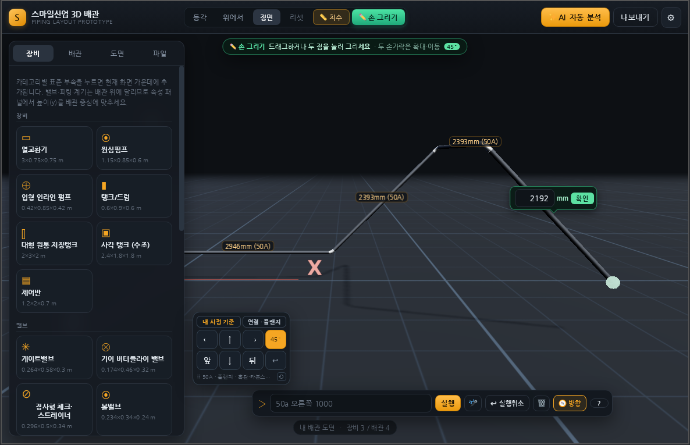


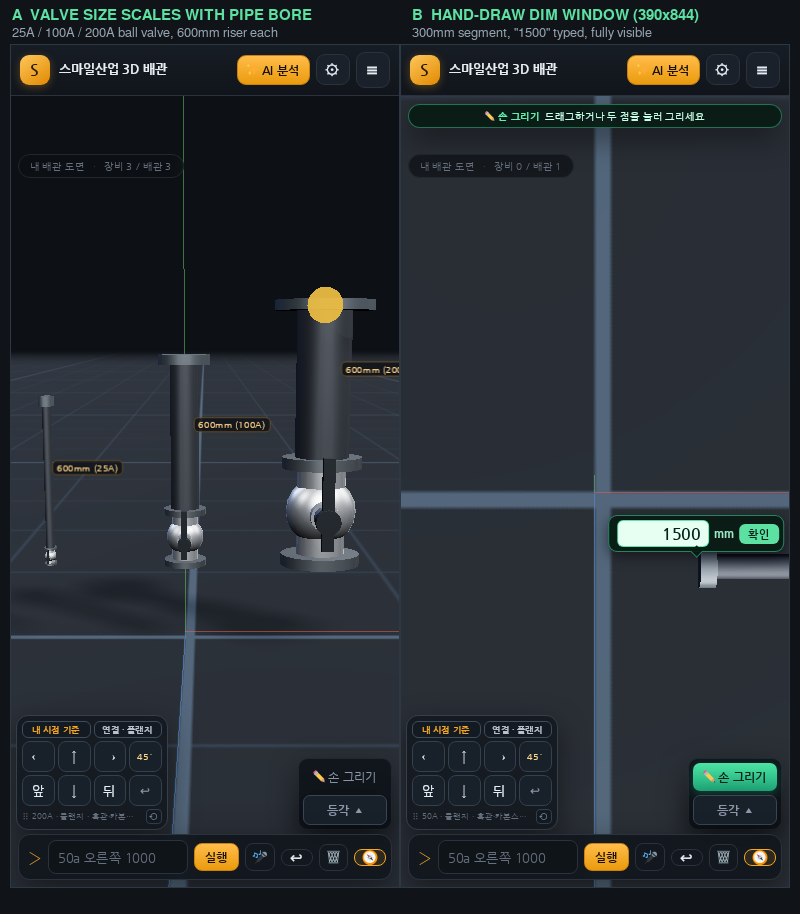

## 파일

```
index.html            화면
css/style.css         스타일
js/store.js           데이터 모델 · 샘플 씬
js/builders.js        3D 장비/배관 빌더 (Three.js)
js/fusion.js          Fusion 360 .py 생성기
js/obj.js             OBJ 내보내기
js/ai.js              Gemini 이미지 분석
js/cmd.js             mm 한 줄 배관 명령 파서 (한국어, 로컬)
js/dims.js            배관 치수 라벨 위치·문구 계산
js/main.js            앱 로직 · UI
vendor/               three.js r160 (로컬 번들)
```

## Fusion 360으로 넘기기

1. 앱에서 **[파일] → Fusion 360 스크립트(.py) 저장**
2. Fusion 360 → 도구 → 스크립트 및 추가기능 → 스크립트 탭 → 생성 → 스크립트
   (언어 Python, 이름 `SmilePiping3D`)
3. 생성된 `SmilePiping3D.py`를 내려받은 파일로 덮어쓰기
4. 스크립트 목록에서 실행 → 새 문서에 장비·배관이 실제 바디로 생성됩니다.

웹앱 1m = Fusion 내부 단위 100cm. Fusion 화면 단위를 mm로 두면 치수가 그대로 보입니다.
