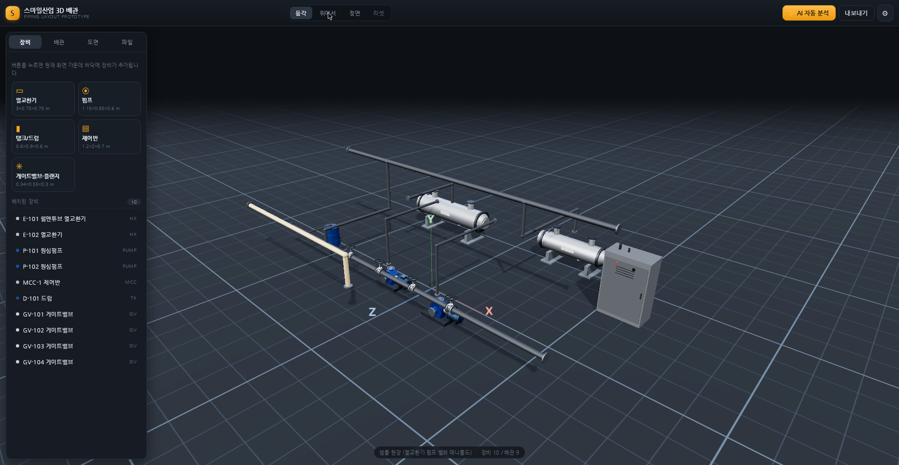
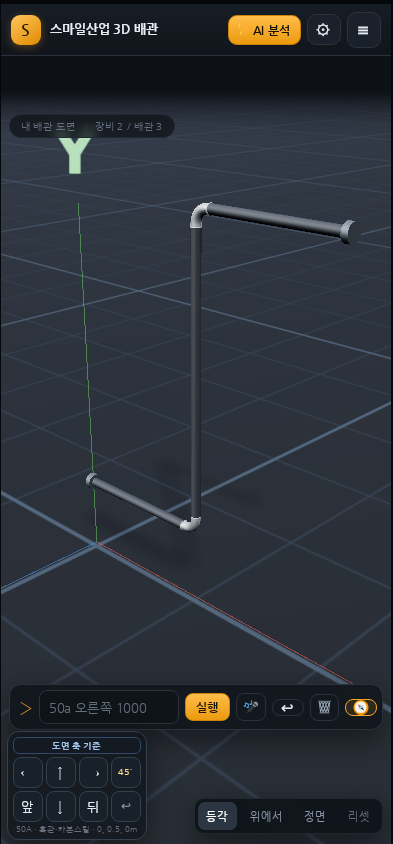

# 스마일산업 3D 배관 (Smile Piping 3D)

현장 사진·2D 도면·손그림을 바탕으로 **장비 위치와 배관 루트(경로·분기·밸브 위치)** 를
빠르게 3D로 잡고, 현장에서 돌려보며 설명하고, **Fusion 360**으로 넘길 수 있는 웹 프로토타입입니다.

- 라이브: https://bks1029-ops.github.io/smile-piping-3d/
- 단위: 미터(m), 1m 격자, Y축이 높이
- 설치 없이 브라우저에서 바로 실행 (Three.js 로컬 번들, CDN 의존 없음)







## 기능

1. **실시간 3D 뷰어** — OrbitControls 회전·확대·이동(모바일 터치 지원),
   등각 / 위에서 / 정면 / 리셋 뷰 전환, 1m 그리드와 X·Y·Z 축 표시
2. **기본 샘플 씬** — 현장 사진을 참고한 열교환기(쉘앤튜브·새들 지지대) 2기,
   원심펌프 3대(가로형·입형 인라인), 게이트밸브 4개 매니폴드, 상부·하부 배관, 제어반, 드럼,
   대형 원통 저장탱크·사각 수조, 그리고 헤더 1줄에 모은 표준 부속 진열 라인
3. **도면 바닥 깔기** — 사진·도면을 3D 바닥에 반투명으로 깔고 투명도·크기·회전·위치 조절
4. **장비·부속 라이브러리 24종 (카테고리별)**
   - 장비: 열교환기 · 원심펌프 · 입형 인라인 펌프 · 탱크/드럼 · 대형 원통 저장탱크 · 사각 탱크(수조) · 제어반
   - 밸브: 게이트밸브 · 기어 버터플라이 · 경사형 체크·스트레이너 · 볼밸브 · 체크밸브(웨이퍼)
   - 피팅·서포트: 벨로우즈 신축관 · 90° 엘보 · **45° 엘보** · 티 분기관 · 레듀샤 ·
     **니쁠(단니쁠)** · **엔드캡(마개)** · **유니온(소켓)** · 플랜지 · 파이프 서포트
   - 계기: 압력계·온도계 · **유량계(플로우미터)**
   - 레듀샤·티는 **1차/2차 관경을 실제 외경으로 반영**합니다. `100a에서 50a 레듀샤`처럼 말하면
     큰 관경에서 작은 관경으로 줄어드는 원뿔로 그려지고, 이어지는 배관도 50A로 자동 전환됩니다.
     속성 패널에서 관경을 다시 바꿀 수도 있습니다.
   - 부속의 3D 메시 접합면 폭과 커서 전진 폭을 1:1로 맞춰, 배관→플랜지→밸브가 **틈 없이** 이어집니다.
   선택 후 위치·크기·회전·색상·이름 수정, 복제·삭제
   배관은 점을 찍어 파이프+엘보 자동 생성, 구경(**15A~600A** KS 표준 20종: 15·20·25·32·40·50·65·80·100·125·150·200·250·300·350·400·450·500·550·600A)·재질(흑관·SUS·보온) 선택
5. **AI 자동 분석 (선택)** — Google Gemini API 키를 넣으면 사진/손그림을 분석해
   장비·배관 JSON을 자동 생성 (키가 없어도 나머지 기능은 모두 동작)
   분석하는 동안 화면 꺼짐을 막고(Screen Wake Lock), 창을 닫아도 분석은 계속되어 결과를 알려줍니다.
6. **mm 한 줄 배관 명령** — 화면 아래 입력창에 현장 말투로 한 줄만 써도 배관이 이어집니다. API 없이 브라우저에서 즉시 실행.
   - `50a 오른쪽으로 1000 위로 1500` — 숫자는 **mm**(1.5m처럼 단위를 붙이면 미터)
   - `50a 오른쪽으로 1000 끝에 플렌지,다음 벨브,다음 플렌지,다음 1000,엘보써서 위로 1000`
   - 방향: 오른쪽(+X) 왼쪽(−X) 위(+Y) 아래(−Y) 앞(+Z) 뒤(−Z). 방향을 빼면 직전 방향으로 이어집니다(`다음 1000`).
   - 부속·장비 24종 별칭(플렌지·벨브·버터·스트레이너·후렉시블·엘보·레듀샤·니쁠·캡·유니온·유량계 등)은
     현재 위치에 진행 방향으로 붙고, 부속의 실제 길이만큼만 커서가 전진해 서로 겹치지도 떨어지지도 않습니다.
   - `오른쪽 45도 위 1000` — 45° 경사 상승 1m(수직 0.71 · 수평 0.71)
   - `100a에서 50a 레듀샤` · `100x50 레듀샤` · `100a 티 50a 분기` — 이경 사이즈 반영
   - `새배관` · `되돌리기` · `초기화` · `?`(예시)
7. **방향 조이스틱 (타자 없이)** — 명령창 아래(모바일은 왼쪽 아래)의 작은 D패드에서 방향을 **고르면 그 방향이 주황색으로 강조**되고,
   명령창에 **`1000`처럼 길이(mm)만** 넣고 [실행]을 누르면 **방금 고른 방향**으로 배관이 그려집니다(같은 방향을 한 번 더 누르면 바로 그립니다).
   3×2 버튼에 ← ↑ → · 앞 ↓ 뒤 + `45°` 경사 토글 + `↩ 실행취소`가 들어 있고, 3D 화면 위쪽 80%는 가리지 않습니다.
8. **🎤 말로 명령** — 명령창의 🎤을 누르고 말하면(Web Speech API, ko-KR) 받아쓰기해 바로 실행합니다.
   `오십에이 오른쪽 천`, `50에이 오른쪽 1000`, `천오백` 같은 구어체도 `50a`·`1000`·`1500`으로 알아듣습니다.
   듣는 동안 버튼에 빨간 점이 깜박이고, 브라우저가 지원하지 않거나 마이크 권한이 거부되면 안내 문구가 뜹니다.
9. **방향 기준 스위치 `[내 시점 기준]` ↔ `[도면 축 기준]`** — 기본값은 `[내 시점 기준]`.
   화면을 90°·180° 돌려도 지금 보는 쪽이 왼쪽·오른쪽·앞·뒤가 됩니다(카메라의 수평 전후·좌우를 가장 가까운 90° 축으로 스냅).
   `[도면 축 기준]`은 기존처럼 고정 X·Z 축이고, 위/아래는 항상 높이(Y)입니다.
10. **자동 엘보** — 배관을 이어 그리다 방향이 꺾이면 꼭짓점에 **90° 엘보 / 45° 엘보**가 각도에 맞춰 자동으로 들어갑니다.
   엘보는 **진입 벡터(inDir)·진출 벡터(outDir) 회전**으로 놓여 XY·YZ·XZ 어느 평면에서 꺾여도 두 입구가 배관과 반듯하게 일치합니다
   (예전에는 Y축 회전만 받아 엘보가 배관을 뚫고 비뚤어졌습니다). 관경(bore)에 맞춘 외경·긴 반경(1.5D) 곡률을 쓰고,
   배관은 엘보 접합면에서 끊겨 겹침 없이 이어집니다. `엘보써서 위로 1000`처럼 직접 말하면 엘보가 두 번 들어가지 않습니다.
   Fusion 360 `.py`에도 같은 치수·방향이 반영됩니다.
11. **🗑️ 새 도면** — 명령창의 🗑️ 버튼 또는 `새도면`·`전체삭제`·`다지워`·`처음부터` 명령으로 장비·배관을 한 번에 지우고
   커서를 원점 (0, 0.5, 0)으로 돌립니다. 바로 직전 상태로 **↩ 실행취소**할 수 있습니다.
12. **실행취소** — 명령창의 **↩ 실행취소** 버튼(또는 조이스틱의 ↩) 한 번으로 직전 명령·부속 추가가 취소되고
   커서·관경·방향도 그 전 자리로 돌아갑니다. `Ctrl+Z`도 같습니다.
13. **말하듯 쓰는 명령** — 조사·군더더기를 무시하고 현장 말투를 알아듣습니다.
   - `밸브 하나 달아줘` · `50미리 위로 좀 올려줘 500` · `오른쪽으로가 500` · `375 올려줘` · `지워`
   - `벨브에 붙혀줘` · `플랜지에 이어줘` — 지금 커서에서 가장 가까운 그 부속까지 배관으로 연결
   - `오른쪽 배관이랑 이어줘` · `배관 연결해줘` — 다른 배관 끝점까지 직교 경로(L자)로 연결
   - 그래도 못 알아들으면(설정에 Gemini API 키가 있을 때) 씬 요약과 함께 AI가 명령으로 바꿔 실행합니다.
14. **손가락 터치 선택** — 작은 밸브·피팅을 32px 안에서 집어 주고(근접 스냅), 선택하면 주황색 커서가
   그 부속의 출구로 옮겨가 바로 다음 배관을 이어 그릴 수 있습니다. 속성 패널의 **📍 여기서 이어 그리기** 버튼으로
   패널을 닫고 이어 그리면 됩니다.
15. **휴대폰 뒤로가기** — 모달·도구 서랍·속성 패널이 열려 있으면 뒤로가기 한 번에 그 창만 닫히고
   페이지는 그대로 남습니다(AI 분석 중에는 창만 접히고 분석은 계속).
16. **내보내기** — JSON 저장/불러오기, **Fusion 360 Python 스크립트(.py)**, **.obj 메쉬**
17. **📏 치수 표시** — 각 배관 구간 중점 옆에 **`1000mm (50A)`**(길이 mm + 관경) 라벨이 3D 좌표에 붙어 따라다닙니다.
   보기 바의 **📏 치수** 버튼으로 켜고 끄며(기본 켜짐), 선택은 `localStorage`(`smilePiping3D.dims`)에 기억됩니다.
18. **부속 축 정렬** — 배관 끝에 붙는 플랜지·밸브·피팅은 진행 방향 벡터(`dir`)로 3D 회전을 잡습니다.
   수직(+Y) 배관 끝 플랜지는 바닥과 평행한 수평 원판, 좌/우(±X)·앞/뒤(±Z) 배관 끝은 배관 축을 정면으로 바라보는 수직 원판,
   45° 경사관 끝은 경사축에 수직인 원판으로 배관 중심축에 딱 맞물립니다(예전에는 Y축 회전만 받아 90° 비뚤어졌습니다).
   Fusion 360 `.py`에도 같은 정렬 행렬(`rmat`)이 넘어갑니다.


## 파일

```
index.html            화면
css/style.css         스타일
js/store.js           데이터 모델 · 샘플 씬
js/builders.js        3D 장비/배관 빌더 (Three.js)
js/fusion.js          Fusion 360 .py 생성기
js/obj.js             OBJ 내보내기
js/ai.js              Gemini 이미지 분석
js/cmd.js             mm 한 줄 배관 명령 파서 (한국어, 로컬)
js/dims.js            배관 치수 라벨 위치·문구 계산
js/main.js            앱 로직 · UI
vendor/               three.js r160 (로컬 번들)
```

## Fusion 360으로 넘기기

1. 앱에서 **[파일] → Fusion 360 스크립트(.py) 저장**
2. Fusion 360 → 도구 → 스크립트 및 추가기능 → 스크립트 탭 → 생성 → 스크립트
   (언어 Python, 이름 `SmilePiping3D`)
3. 생성된 `SmilePiping3D.py`를 내려받은 파일로 덮어쓰기
4. 스크립트 목록에서 실행 → 새 문서에 장비·배관이 실제 바디로 생성됩니다.

웹앱 1m = Fusion 내부 단위 100cm. Fusion 화면 단위를 mm로 두면 치수가 그대로 보입니다.
